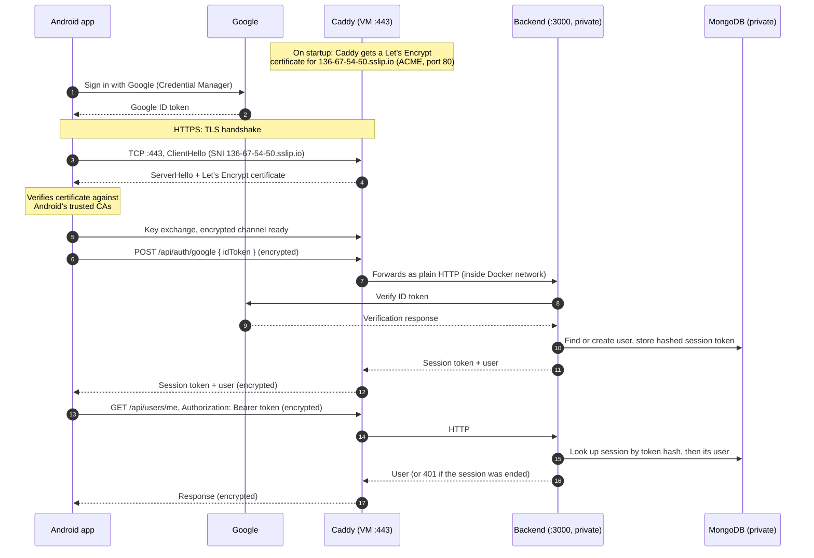

[](https://app.codacy.com/gh/adamdeleeuw/trailmix/dashboard?utm_source=gh&utm_medium=referral&utm_content=&utm_campaign=Badge_grade)
[](https://app.codacy.com/gh/adamdeleeuw/trailmix/dashboard?utm_source=gh&utm_medium=referral&utm_content=&utm_campaign=Badge_coverage)

# Trailmix

Trailmix is an Android app for planning commutes that combine driving and transit. You save your car, how you pay for transit, and parking spots you're happy to leave the car at. The Planner then compares driving, transit, and driving to one of your spots and taking transit from there, and returns up to three priced routes: Cheapest, Fastest and Balanced. You can preview a route on the map, save it for later, or start it and get guided leg by leg. History lists your trips with their totals and commute insights.

The app is Kotlin and Jetpack Compose (`frontend/`). The backend is a Node.js, TypeScript and Express server with MongoDB (`backend/`).

> **Metro Vancouver only.** Trailmix is built for Metro Vancouver. Transit fares and fare zones are TransLink's (its fare table and the SkyTrain stations' zones are in the backend), and place search is biased to Metro Vancouver. Routes and transit schedules come from the Google Routes API, so a trip elsewhere may still plan, but it's priced with TransLink's fares and won't be right. Trailmix doesn't use any other transit agency's data, and it doesn't call a TransLink API yet (live TransLink delays are planned for CP3).

## Run the app with the APK

1. Open Android Studio, click the three dots in the top right corner, and select **Virtual Device Manager**.
2. Add a **Pixel 9** with the **Android 16.0 (API 36)** system image that includes **Google Play**, so you can sign in with Google.
3. Start the Pixel 9, and sign in to Google with your Google account. The app's **Continue with Google** uses the account on the device.
4. Set the emulator's location to somewhere in Metro Vancouver (see [Set the emulator's location](#set-the-emulators-location)).
5. Drag the APK onto the emulator window to install it (or run `adb install -r app.apk`).
6. Swipe up from the bottom to open the app menu and select **Trailmix**.

The APK points at the deployed backend, `https://136-67-54-50.sslip.io`. Any Google account can sign in.

### Set the emulator's location

The emulator starts in Mountain View, California. The Map tab opens on your location, and Directions plans from it, so set it to somewhere in Metro Vancouver:

- In the emulator's toolbar, click **⋯** (Extended controls), then **Location**. Search for a place such as `UBC` or `Waterfront Station`, and click **Set location**.
- Or, from a terminal: `adb emu geo fix -123.2460 49.2606` (longitude, then latitude, here UBC).

## Run the tests

Run every script from the repository root. Each one has a `.sh` version for macOS, Linux and Git Bash, and a `.ps1` version for Windows PowerShell.

### Backend tests

You need **Node.js 22** and **Docker** (running). The tests don't need `backend/.env` or real Google keys, since they fake Google's responses.

```bash
./scripts/run-backend-interface-tests.sh   # Windows: .\scripts\run-backend-interface-tests.ps1
```

The script starts the `mongo` container from `docker-compose.yml` for the tests' database, installs the backend's packages if they're missing, and runs the API tests three times: `tests/mock/`, `tests/no-mock/`, then both together. Each run writes an HTML coverage report to `backend/coverage/mock/`, `backend/coverage/no-mock/` and `backend/coverage/interface/`. Open `index.html` in any of them.

The response time test (the non-functional requirement) has its own script. It doesn't start MongoDB, so run it after the script above, or start the container first with `docker compose up -d --wait mongo`:

```bash
./scripts/run-backend-nfr-tests.sh         # Windows: .\scripts\run-backend-nfr-tests.ps1
```

### Front-end end-to-end tests

The tests are in `frontend/app/src/androidTest/java/com/example/cpen321application/e2e/`. They run on a real emulator, against the backend in `API_BASE_URL`.

**Before you run them:**

1. Set up the app as in [Frontend](#frontend): `frontend/local.properties` with your keys and an `API_BASE_URL`. The deployed backend (`https://136-67-54-50.sslip.io`) works. The script also starts the local backend, so `backend/.env` must exist, as in [Backend](#backend).
2. Create the emulator in Android Studio's Device Manager: a **Pixel 9** with the **Android 16.0 (API 36)** Google Play system image. The script starts the AVD named `Pixel_9`. If yours has another name, set `AVD_NAME` (for example `AVD_NAME=My_Pixel ./scripts/run-frontend-e2e-tests.sh`, or `$env:AVD_NAME = "My_Pixel"` in PowerShell).
3. On the emulator, sign in to Google, and [set the location](#set-the-emulators-location) to somewhere in Metro Vancouver.
4. Use a Google account that, in Trailmix, has finished the questionnaire, has **no saved parking spots**, has **no active trip**, and keeps the default modes (Drive and Transit). `PlanTripTest` checks the "no parking spots" banner, so it fails on an account with saved spots. It saves its own spot during the test and deletes it afterwards.

**Run them:**

```bash
./scripts/run-frontend-e2e-tests.sh        # Windows: .\scripts\run-frontend-e2e-tests.ps1
```

1. The script starts the backend with Docker, starts the emulator (or uses the one already running), and builds, installs and opens the app.
2. When it asks, sign in **inside the app** with the account from step 4 above, and wait for the Map tab.
3. Press **Enter** in the terminal. The script runs every test class in `e2e/` and prints how many passed. Each test's result is in `frontend/app/build/outputs/androidTest-results/connected/debug/`.

## Architecture

In production the backend runs in Docker on a GCP VM behind **Caddy**, which terminates HTTPS with a publicly trusted **Let's Encrypt** certificate for `136-67-54-50.sslip.io`. Port 3000 is never exposed to the internet; only Caddy can reach the backend, over the private Docker network.



Release builds of the app only allow HTTPS. Debug builds additionally allow plain HTTP to `10.0.2.2` so the app can talk to a backend running locally.

## Build and deploy

Clone the repo:

```bash
git clone git@github.com:adamdeleeuw/trailmix.git
cd trailmix
```

### Backend

```bash
cd backend
cp .env.example .env
```

Fill in `backend/.env`:

```dotenv
GOOGLE_BACKEND_CLIENT_ID=<your Google Web client ID>.apps.googleusercontent.com
GOOGLE_ROUTES_API_KEY=<a Google Cloud API key with the Routes API enabled>
MONGODB_URI=mongodb://localhost:27017/trailmix
```

**Local:**

```bash
docker compose up -d --wait mongo  # MongoDB on 127.0.0.1:27017 (run from the repo root)
npm install
npm run build && npm run start     # serves plain HTTP on http://localhost:3000
```

**VM:** the VM runs the backend, MongoDB and Caddy with Docker (Docker must be installed, and `backend/.env` must exist on the VM). The deploy script syncs the clone to `origin/main`, starts the containers and waits for `https://136-67-54-50.sslip.io/health` to respond:

```bash
~/cpen321-m1/scripts/deploy-backend.sh
```

In practice you don't run this by hand. The GitHub Actions workflow `.github/workflows/backend.yml` runs on every push to `main`: it typechecks, tests and builds the backend, then SSHes into the VM and runs `deploy-backend.sh`. This is the intended way to deploy the HTTPS server.

### Database login and backups

Production MongoDB requires a login, and the database is backed up every night, gpg-encrypted, to `gs://cpen321-m1-508304-trailmix-backups` (Toronto, kept 14 days). Only the backup key holders can decrypt a backup, and the VM can only add files to the bucket, not read or delete them.

**MongoDB users.** `docker-compose.prod.yml` starts MongoDB with `--auth`. Create the users before that change first deploys, while MongoDB still accepts connections without a login. `passwordPrompt()` keeps the passwords out of the shell history:

```bash
docker exec -it cpen321-project-mongo-1 mongosh admin
```

```js
db.createUser({ user: 'admin', pwd: passwordPrompt(), roles: ['root'] }) // password only in the password manager, never on the VM
db.createUser({ user: 'trailmix_app', pwd: passwordPrompt(), roles: [{ role: 'readWrite', db: 'trailmix' }] })
db.createUser({ user: 'trailmix_backup', pwd: passwordPrompt(), roles: ['backup'] })
```

Then set the backend's connection in `backend/.env` on the VM. The production stack takes `MONGODB_URI` from this file:

```dotenv
MONGODB_URI=mongodb://trailmix_app:<app password>@mongo:27017/trailmix?authSource=admin
```

Use passwords from `openssl rand -hex 32`, so they need no escaping in the URI. Local development and the tests keep MongoDB without a login. It listens only on `127.0.0.1` and holds no real user data.

**Backups.** [`scripts/backup-mongo.sh`](scripts/backup-mongo.sh) streams `mongodump` through `gpg --encrypt` into the bucket, so no plaintext copy is written to the VM's disk. To set it up on the VM, as root:

1. Import each key holder's public key: `gpg --import holder-1.asc`. Each holder makes their own key pair, and private keys never go on the VM.
2. Create `/etc/trailmix/backup.env`, readable by root only (`chmod 600`), with `MONGO_BACKUP_PASSWORD=<trailmix_backup password>` and `BACKUP_GPG_RECIPIENTS="<fingerprint 1> <fingerprint 2>"` (one fingerprint per holder, separated by spaces).
3. Add the cron entry from the top of the script, then run it once by hand.

Check that last night's backup exists with `gcloud storage ls -l gs://cpen321-m1-508304-trailmix-backups/mongo/`, and check the VM's log with `journalctl -t trailmix-backup`.

**Restoring** (a key holder's laptop, with Docker running):

```bash
./scripts/restore-mongo.sh gs://cpen321-m1-508304-trailmix-backups/mongo/<file> # into trailmix_restore_drill
```

The script restores into a separate database on the local compose MongoDB and refuses to write to `trailmix`. Use it for the restore drill and to inspect a backup. To restore production, first check the backup locally that way. Then stream it into the VM's MongoDB as the admin user:

```bash
gcloud storage cat gs://cpen321-m1-508304-trailmix-backups/mongo/<file> | gpg --decrypt |
  gcloud compute ssh cpen321-backend-vm-adam --zone us-west1-a --   "docker exec -i cpen321-project-mongo-1 mongorestore --archive --gzip --drop --nsInclude 'trailmix.*' --username admin --authenticationDatabase admin --password '<admin password>'"
```

This replaces every collection in `trailmix`, so take a fresh backup first.

### Frontend

```bash
cd frontend
cp local.properties.example local.properties
```

Fill in `frontend/local.properties`:

```properties
sdk.dir=<path to your Android SDK>
GOOGLE_CLIENT_ID=<your Google Web client ID>.apps.googleusercontent.com
MAPS_API_KEY=<a Google Cloud API key with the Maps SDK for Android enabled>
PLACES_API_KEY=<a key with Places API (New) enabled, restricted to this app; empty uses MAPS_API_KEY>

# pick one:
API_BASE_URL=http://10.0.2.2:3000             # backend running locally
API_BASE_URL=https://136-67-54-50.sslip.io    # backend deployed on the VM
```

Then build and run:

```bash
./gradlew build
```

1. Go to **Tools → Device Manager** and set up the Pixel 9 emulator as described in [Run the app with the APK](#run-the-app-with-the-apk).
2. Click **Run app** (the green play button) in Android Studio.

### Frontend end-to-end tests

The instrumented tests in `frontend/app/src/androidTest/.../e2e/` exercise the installed app against the configured backend. Run them locally from the repository root:

```powershell
.\scripts\run-frontend-e2e-tests.ps1
```

The script starts the local Docker backend and frontend, then waits for a signed-in app session on the emulator. Before running:

- Configure `backend/.env` with `GOOGLE_BACKEND_CLIENT_ID`, `GOOGLE_ROUTES_API_KEY`, `MONGODB_URI`, and, for station fallback, `GOOGLE_PLACES_API_KEY`.
- Configure `frontend/local.properties` with `sdk.dir`, `GOOGLE_CLIENT_ID`, `MAPS_API_KEY`, and `API_BASE_URL=http://10.0.2.2:3000`.
- Start Docker Desktop and create/start the Pixel 9 Android 16 (API 36) Google Play emulator. Sign in to the app with a test account that has completed its profile.
- Enable the Google Places and Routes APIs and billing for the configured keys. E2E place search and route geometry use these live services.

For example, `BicyclePlanTest` covers Bike + Transit, bicycle-only, both bicycle/transit handoff directions, saved Bike + Transit preferences after relaunch, and Drive-/Transit-only regressions. It asserts the returned route's bicycle timeline, map marker, and green icon. Tests save temporary planning defaults and restore the account's original preferences afterward.

These E2E tests are not run in CI. Frontend CI runs `./gradlew testDebugUnitTest assembleDebug`; it does not have an emulator, signed-in account, or live Maps/Routes credentials. There is currently no dedicated local fixture backend wired into the Android app, so E2E route choices and place results depend on live Google data and can vary. Deterministic mocked API and component coverage remains in the instrumented API/visual tests and backend test suites.
