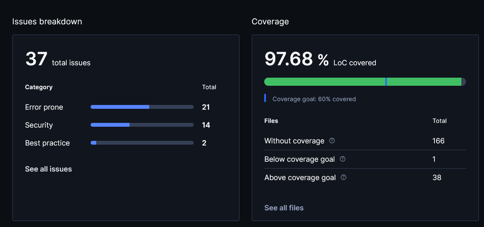
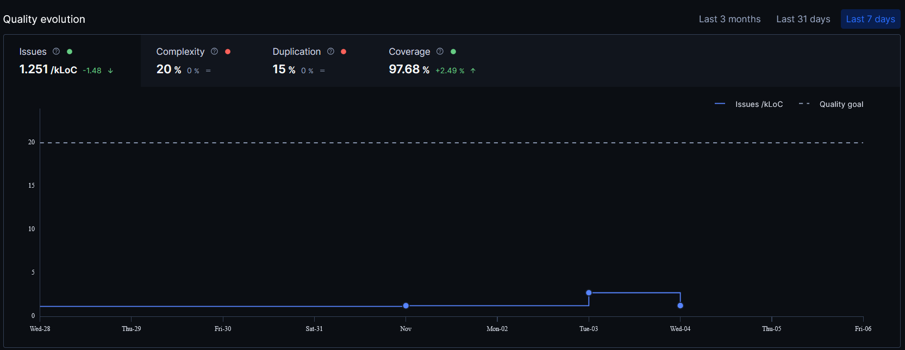
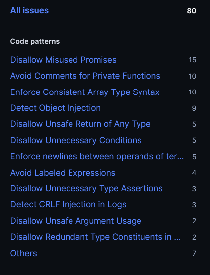
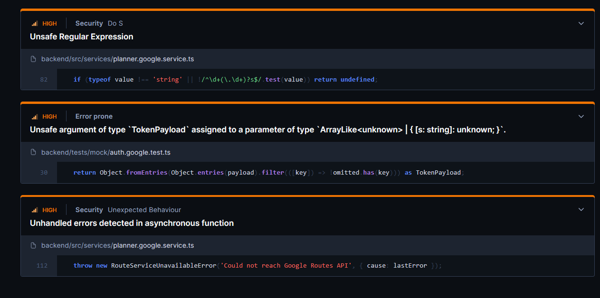

# Code Review

## 1. Change History

| **Change Date**   | **Modified Sections** | **Rationale** |
| ----------------- | --------------------- | ------------- |
| 2026-10-16        | 2.4 | Justified the "Promise returned in function argument" warnings on the Express routes (issue #10) |
| 2026-10-19        | 2.4 | Justified the "Promise returned in function argument" warning on the chained route and the "Unsafe return of an error typed value" warning in its tests (issue #7) |
| 2026-10-20        | 2.1, 2.2, 2.3, 2.4, 3 | Added the commit Codacy ran on and the Codacy screenshots for CP1, noted that the remaining issues are carried forward to CP2, and noted that the manual review is filled in after the class peer review |
| 2026-11-04        | 2.1, 2.2, 2.3, 2.4 | Updated the commit Codacy ran on and the Codacy screenshots for CP2, after the Planner (#72), Planning and Trip Preview (#73) and trip lifecycle (#74) merged. Grouped the justifications by code pattern, added the new false positives with citations, and removed the `routes.chained` justifications, since that endpoint and its tests were deleted |

---

## 2. Automated Code Review Results

### 2.1. Commit Hash Where Codacy Ran

`4631dafd6b64b3c5b533fd9d6ba7736c7338c3f0`

This is the last commit on `main` that changes code, the same one the tests run on (see `Testing.md` 2.1.2). Later commits only change documentation, so Codacy reports the same issues on them.

### 2.2. Unfixed Issues per Codacy Category

### 2.3. Unfixed Issues per Codacy Code Pattern

The issues under the "Others" category are:

### 2.4. Justifications for Unfixed Issues

Every issue left open in 2.2 and 2.3 is listed below, grouped by code pattern. Each one is a false positive, and the justification says why, with a source.

- **Code Pattern: Promise returned in function argument where a void return was expected** (`@typescript-eslint/no-misused-promises`)

  1. **Issues**

     - **Location in Git:** [`backend/src/routes/auth.route.ts#L7`](../backend/src/routes/auth.route.ts#L7), [`#L8`](../backend/src/routes/auth.route.ts#L8), [`backend/src/routes/users.route.ts#L15`](../backend/src/routes/users.route.ts#L15) to [`#L27`](../backend/src/routes/users.route.ts#L27) (13 issues, one per route), [`backend/src/routes/planner.route.ts#L7`](../backend/src/routes/planner.route.ts#L7), and the 3 issues ignored in Codacy in CP1 on [`backend/src/routes/vehicles.route.ts#L7`](../backend/src/routes/vehicles.route.ts#L7) and [`#L8`](../backend/src/routes/vehicles.route.ts#L8)
     - **Justification:** The rule's `checksVoidReturn` option reports a promise-returning function passed where a function returning `void` is expected, because a plain callback that returns a promise can lose its rejection ([typescript-eslint: no-misused-promises](https://typescript-eslint.io/rules/no-misused-promises/#checksvoidreturn)). Express 5 route handlers don't have that problem. Express documents that "starting with Express 5, route handlers and middleware that return a Promise will call `next(value)` automatically when they reject or throw an error" ([Express: Error Handling](https://expressjs.com/en/guide/error-handling.html#catching-errors)), so every rejection from `requireSession` or a controller reaches our error handler. Express 5's own types (`@types/express-serve-static-core` 5) declare a handler's return type as `unknown`, not `void`, so with the installed types the rule has nothing to report. Codacy reports it because its analysis doesn't load the project's installed type definitions. The mocked API tests show it in practice: a failing database call returns a 500 instead of crashing the server. Wrapping every handler to silence the rule would add code that does nothing Express 5 doesn't already do.

- **Code Pattern: Unsafe return of an error typed value, unsafe argument, and redundant type constituents** (`@typescript-eslint/no-unsafe-return`, `@typescript-eslint/no-unsafe-argument`, `@typescript-eslint/no-redundant-type-constituents`)

  1. **Issues**

     - **Location in Git:** [`backend/src/services/google.service.ts#L13`](../backend/src/services/google.service.ts#L13), [`backend/tests/mock/auth.google.test.ts#L30`](../backend/tests/mock/auth.google.test.ts#L30), [`#L34`](../backend/tests/mock/auth.google.test.ts#L34), [`#L35`](../backend/tests/mock/auth.google.test.ts#L35), [`#L115`](../backend/tests/mock/auth.google.test.ts#L115), [`backend/tests/mock/routes.plan.test.ts#L93`](../backend/tests/mock/routes.plan.test.ts#L93), [`#L98`](../backend/tests/mock/routes.plan.test.ts#L98), [`backend/tests/no-mock/users.planning-preferences.test.ts#L35`](../backend/tests/no-mock/users.planning-preferences.test.ts#L35)
     - **Justification:** Each line uses a type from an installed package: `OAuth2Client` and `TokenPayload` from `google-auth-library`, and the request built by `supertest` (`@types/supertest`). "Error typed" is what typescript-eslint calls a type TypeScript couldn't resolve, and type-aware rules can only work when the linter has the project's full type information, including its dependencies ([typescript-eslint: Linting with Type Information](https://typescript-eslint.io/getting-started/typed-linting/)). Codacy lints without the installed packages, so these types become the error type, which the rules then treat like `any`. With the real types these are an `OAuth2Client`, a `TokenPayload` and a `supertest` `Test`, and `npm run typecheck` (strict mode, run in CI on every push) passes with no errors.

- **Code Pattern: Generic Object Injection Sink** (`security/detect-object-injection`)

  1. **Issues**

     - **Location in Git:** [`backend/src/config/env.ts#L24`](../backend/src/config/env.ts#L24), [`backend/src/services/planner.constants.ts#L23`](../backend/src/services/planner.constants.ts#L23), [`#L25`](../backend/src/services/planner.constants.ts#L25), [`#L27`](../backend/src/services/planner.constants.ts#L27), [`backend/src/services/planner.service.ts#L479`](../backend/src/services/planner.service.ts#L479), [`backend/src/services/route-legs.ts#L150`](../backend/src/services/route-legs.ts#L150), [`#L159`](../backend/src/services/route-legs.ts#L159), [`#L166`](../backend/src/services/route-legs.ts#L166), [`backend/tests/no-mock/routes.plan.test.ts#L88`](../backend/tests/no-mock/routes.plan.test.ts#L88)
     - **Justification:** The rule flags every `object[variable]`, whatever the variable is ([eslint-plugin-security: detect-object-injection](https://github.com/eslint-community/eslint-plugin-security/blob/main/docs/rules/detect-object-injection.md)). The risk is a key the user controls, such as `__proto__`, reaching a property lookup or assignment ([OWASP: Prototype Pollution Prevention](https://cheatsheetseries.owasp.org/cheatsheets/Prototype_Pollution_Prevention_Cheat_Sheet.html)). None of these keys come from a user. In `planner.service.ts`, `route-legs.ts` and the test, the key is a loop's number index into an array. In `planner.constants.ts` it is `tier`, typed `0 | 1 | 2` and computed from a zone count. In `env.ts` it is the name of a required environment variable, which only the code passes in.

- **Code Pattern: Detect console.log() with non Literal argument** (`security-node/detect-crlf`)

  1. **Issues**

     - **Location in Git:** [`backend/src/index.ts#L12`](../backend/src/index.ts#L12), [`backend/tests/nfr/planner.response-time.test.ts#L124`](../backend/tests/nfr/planner.response-time.test.ts#L124), [`#L125`](../backend/tests/nfr/planner.response-time.test.ts#L125)
     - **Justification:** The rule guards against log injection, where a user-supplied string with line breaks forges extra log lines ([OWASP: Log Injection](https://owasp.org/www-community/attacks/Log_Injection)). These lines only log numbers: `index.ts` logs `env.port`, which `env.ts` parses as an integer at startup, and the NFR test logs response times formatted with `toFixed`. Neither can contain a line break, and neither comes from a request.

- **Code Pattern: Unsafe Regular Expression** (`security/detect-unsafe-regex`)

  1. **Issue**

     - **Location in Git:** [`backend/src/services/planner.google.service.ts#L82`](../backend/src/services/planner.google.service.ts#L82)
     - **Justification:** The pattern is `/^\d+(\.\d+)?s$/`, which reads Google's durations like `"900s"`. A regular expression is only open to ReDoS when it can match the same text in many ways, as with nested or overlapping quantifiers like `(a+)+` ([OWASP: ReDoS](https://owasp.org/www-community/attacks/Regular_expression_Denial_of_Service_-_ReDoS)). Here the optional group must start with a literal `.`, which `\d` can't match, so each input has at most one way to match and the check runs in linear time. The rule only counts quantifiers and can't see that. The input is also a field of Google's response, not user input.

- **Code Pattern: Unhandled errors detected in asynchronous function** (`security-node/detect-unhandled-async-errors`)

  1. **Issue**

     - **Location in Git:** [`backend/src/services/planner.google.service.ts#L112`](../backend/src/services/planner.google.service.ts#L112)
     - **Justification:** The flagged line is the deliberate `throw` of `RouteServiceUnavailableError` after both attempts fail, inside the `try`/`catch` loop that retries Google once. The error is handled: `planRoute` catches it and returns `503`, and anything else reaches the error handler through `.catch(next)` in `planner.route.ts`. The mocked `POST /api/routes/plan` tests check this, since a failing Google call returns `503` instead of crashing. The rule's documentation asks for an async function's errors to be handled with `try`/`catch`, `.catch`, or a separate error handler ([eslint-plugin-security-node: detect-unhandled-async-errors](https://github.com/gkouziik/eslint-plugin-security-node/blob/master/docs/rules/detect-unhandled-async-errors.md)), and this code does the first two.

---

## 3. Manual Code Review Results

_This section will be filled in after our class does the peer code review, so the placeholders below are left until then._

### 3.1. Review You Performed

- **Peer group reviewed:** [WRITE_HERE]
- **Commit SHA reviewed:** `[Insert Commit SHA here]`
- **Date the artifacts were exchanged:** [WRITE_HERE]
- **Review report submitted:** [`<CP#>_<YourPeerGroupName>_Review.pdf`](#)

| **Section**          | **Item**                                                                                                                                             | **Score** |
| -------------------- | ---------------------------------------------------------------------------------------------------------------------------------------------------- | --------- |
| Manual code review   | Code is maintainable (well-documented, uses self-explanatory variable names, does not have complicated and long methods, magic numbers, etc.), efficient, handles error cases well | x/10      |
| Manual test review   | Tests are complete (all APIs exposed to the front-end are tested, three main features are tested), errors and edge cases are thoroughly tested, correct assertions are used | x/10      |
| Manual test review   | Test code is maintainable and well-structured                                                                                                          | x/10      |
| Manual test review   | Test implementation matches the requirements and design                                                                                                | x/10      |
| Manual test review   | Non-functional requirements are tested well                                                                                                            | x/10      |
| Manual test review   | Tests achieve high coverage and cases of < 100% coverage are well-justified                                                                            | x/10      |
| Manual test review   | All back-end tests can be run automatically                                                                                                            | x/10      |
| Automated code review| Codacy runs with the required setup                                                                                                                    | x/10      |
| Automated code review| All remaining Codacy issues are well-justified                                                                                                          | x/10      |

**Major fault reported**

- **Description:** ...
- **Steps to reproduce:** ...
- **Screenshots:** _(Placeholder for screenshots of the reported fault)_
- **Severity:** ...

### 3.2. Review You Received

- **Reviewing group:** [WRITE_HERE]
- **Commit SHA that was reviewed:** `[Insert Commit SHA here]`
- **Review report received:** [`<CP#>_<YourGroupName>_Review.pdf`](#)

| **Section**          | **Item**                                                                                                                                             | **Score** |
| -------------------- | ---------------------------------------------------------------------------------------------------------------------------------------------------- | --------- |
| Manual code review   | Code is maintainable, efficient, handles error cases well                                                                                               | x/10      |
| Manual test review   | Tests are complete, errors and edge cases are thoroughly tested, correct assertions are used                                                            | x/10      |
| Manual test review   | Test code is maintainable and well-structured                                                                                                          | x/10      |
| Manual test review   | Test implementation matches the requirements and design                                                                                                | x/10      |
| Manual test review   | Non-functional requirements are tested well                                                                                                            | x/10      |
| Manual test review   | Tests achieve high coverage and cases of < 100% coverage are well-justified                                                                            | x/10      |
| Manual test review   | All back-end tests can be run automatically                                                                                                            | x/10      |
| Automated code review| Codacy runs with the required setup                                                                                                                    | x/10      |
| Automated code review| All remaining Codacy issues are well-justified                                                                                                          | x/10      |

**Major fault reported against your project**

- **Description:** ...
- **Severity:** ...

### 3.3. Actions Taken in Response to the Review

| **Finding** | **Action Taken** | **Commit / Location in Git** |
| ----------- | ---------------- | ---------------------------- |
| ...         | ...              | [`src/...`](#)               |
| ...         | ...              | ...                          |

- **Findings not acted on.** For each finding you decided not to address, give the reason:
  1. **Finding:** ...
     - **Justification:** ...
