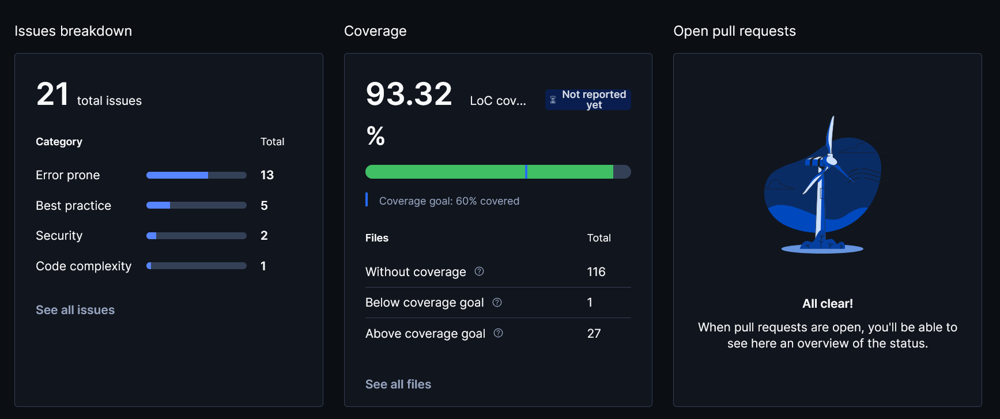
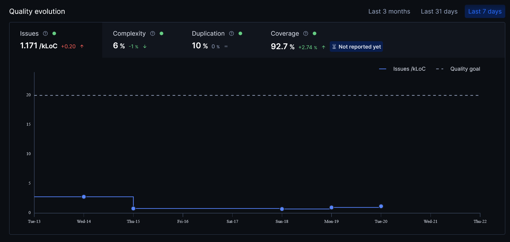
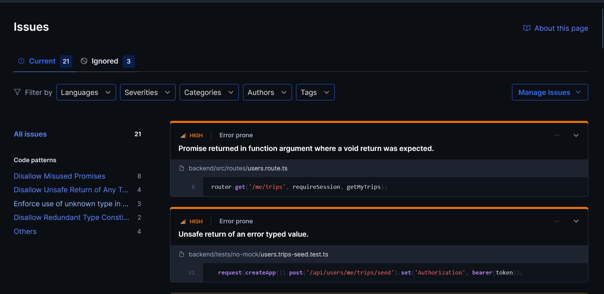
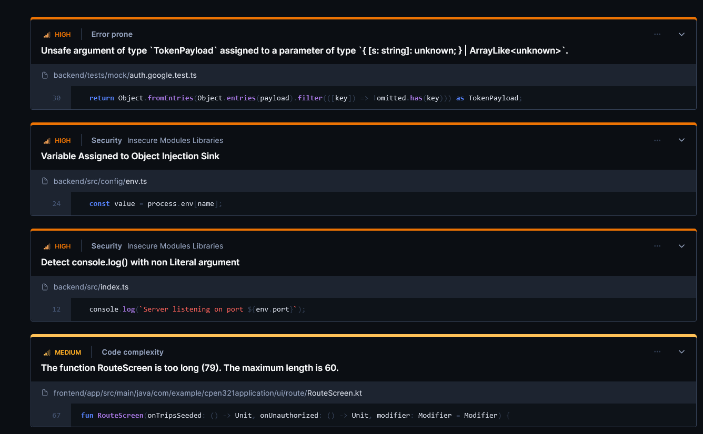

# Code Review

## 1. Change History

| **Change Date**   | **Modified Sections** | **Rationale** |
| ----------------- | --------------------- | ------------- |
| 2026-10-16        | 2.4 | Justified the "Promise returned in function argument" warnings on the Express routes (issue #10) |
| 2026-10-19        | 2.4 | Justified the "Promise returned in function argument" warning on the chained route and the "Unsafe return of an error typed value" warning in its tests (issue #7) |
| 2026-10-20        | 2.1, 2.2, 2.3, 2.4, 3 | Added the commit Codacy ran on and the Codacy screenshots for CP1, noted that the remaining issues are carried forward to CP2, and noted that the manual review is filled in after the class peer review |

---

## 2. Automated Code Review Results

### 2.1. Commit Hash Where Codacy Ran

`f0aefbfc15f9685c0e419d9e059d21525dcdd53e`

This is the last commit that changes code, the same one the tests run on (see `Testing.md` 2.1.2). Later commits only change documentation, so Codacy reports the same issues on them.

### 2.2. Unfixed Issues per Codacy Category

### 2.3. Unfixed Issues per Codacy Code Pattern

The four issues under the "Others" category are:

### 2.4. Justifications for Unfixed Issues

The issues below were justified as they came up in earlier issues. Every other open issue in 2.2 and 2.3 is in our carry-forward task for CP2, where each one will be fixed or justified. Issues 1 to 3 under the first pattern are the 3 issues marked as ignored in Codacy.

- **Code Pattern: Promise returned in function argument where a void return was expected** (`@typescript-eslint/no-misused-promises`)

  1. **Issue**

     - **Location in Git:** [`backend/src/routes/users.route.ts#L9`](../backend/src/routes/users.route.ts#L9)
     - **Justification:** `requireSession` and `saveProfile` are async route handlers. This rule warns because a plain callback that returns a promise can lose its error. Express 5 doesn't have that problem. Its router waits for the promise a handler returns and passes any rejection to `next()`, which sends it to our error handler (`backend/node_modules/router/lib/layer.js`, the `isPromise(ret)` check). Express 5's types also declare a handler's return type as `unknown`, not `void`, so with the real types the rule has nothing to report. Codacy flags it because it can't load the Express types. The mocked API tests prove errors are handled, since a failing database call returns a 500 instead of crashing.

  2. **Issue**

     - **Location in Git:** [`backend/src/routes/vehicles.route.ts#L7`](../backend/src/routes/vehicles.route.ts#L7)
     - **Justification:** Same as above, for the async `requireSession` in front of `getMakes`.

  3. **Issue**

     - **Location in Git:** [`backend/src/routes/vehicles.route.ts#L8`](../backend/src/routes/vehicles.route.ts#L8)
     - **Justification:** Same as above, for the async `requireSession` in front of `getModels`.

  4. **Issue**

     - **Location in Git:** [`backend/src/routes/routes.route.ts#L7`](../backend/src/routes/routes.route.ts#L7)
     - **Justification:** Same as above, for the async `requireSession` and `planChainedRoute` handlers. The mocked API tests prove errors are handled, since a failing Routes API call returns a 500 instead of crashing.

  The same warning on [`backend/src/routes/auth.route.ts`](../backend/src/routes/auth.route.ts) and [`backend/src/routes/users.route.ts#L7`](../backend/src/routes/users.route.ts#L7) was ignored for the same reason in issue #9. Wrapping every handler to silence the rule would add code that does nothing Express 5 doesn't already do.

- **Code Pattern: Unsafe return of an error typed value** (`@typescript-eslint/no-unsafe-return`)

  1. **Issue**

     - **Location in Git:** [`backend/tests/mock/routes.chained.test.ts#L30`](../backend/tests/mock/routes.chained.test.ts#L30)
     - **Justification:** The test helper returns the request built by `supertest`. "Error typed" means Codacy couldn't work out the value's type, because, as with the Express warnings above, it can't load the installed type definitions (here `@types/supertest`). With the real types the value is a `supertest` `Test`, and `npm run typecheck` (strict mode, run in CI) passes with no errors.

---

## 3. Manual Code Review Results

_This section will be filled in after our class does the peer code review, so the placeholders below are left until then._

### 3.1. Review You Performed

- **Peer group reviewed:** [WRITE_HERE]
- **Commit SHA reviewed:** `[Insert Commit SHA here]`
- **Date the artifacts were exchanged:** [WRITE_HERE]
- **Review report submitted:** [`<CP#>_<YourPeerGroupName>_Review.pdf`](#)

| **Section**          | **Item**                                                                                                                                             | **Score** |
| -------------------- | ---------------------------------------------------------------------------------------------------------------------------------------------------- | --------- |
| Manual code review   | Code is maintainable (well-documented, uses self-explanatory variable names, does not have complicated and long methods, magic numbers, etc.), efficient, handles error cases well | x/10      |
| Manual test review   | Tests are complete (all APIs exposed to the front-end are tested, three main features are tested), errors and edge cases are thoroughly tested, correct assertions are used | x/10      |
| Manual test review   | Test code is maintainable and well-structured                                                                                                          | x/10      |
| Manual test review   | Test implementation matches the requirements and design                                                                                                | x/10      |
| Manual test review   | Non-functional requirements are tested well                                                                                                            | x/10      |
| Manual test review   | Tests achieve high coverage and cases of < 100% coverage are well-justified                                                                            | x/10      |
| Manual test review   | All back-end tests can be run automatically                                                                                                            | x/10      |
| Automated code review| Codacy runs with the required setup                                                                                                                    | x/10      |
| Automated code review| All remaining Codacy issues are well-justified                                                                                                          | x/10      |

**Major fault reported**

- **Description:** ...
- **Steps to reproduce:** ...
- **Screenshots:** _(Placeholder for screenshots of the reported fault)_
- **Severity:** ...

### 3.2. Review You Received

- **Reviewing group:** [WRITE_HERE]
- **Commit SHA that was reviewed:** `[Insert Commit SHA here]`
- **Review report received:** [`<CP#>_<YourGroupName>_Review.pdf`](#)

| **Section**          | **Item**                                                                                                                                             | **Score** |
| -------------------- | ---------------------------------------------------------------------------------------------------------------------------------------------------- | --------- |
| Manual code review   | Code is maintainable, efficient, handles error cases well                                                                                               | x/10      |
| Manual test review   | Tests are complete, errors and edge cases are thoroughly tested, correct assertions are used                                                            | x/10      |
| Manual test review   | Test code is maintainable and well-structured                                                                                                          | x/10      |
| Manual test review   | Test implementation matches the requirements and design                                                                                                | x/10      |
| Manual test review   | Non-functional requirements are tested well                                                                                                            | x/10      |
| Manual test review   | Tests achieve high coverage and cases of < 100% coverage are well-justified                                                                            | x/10      |
| Manual test review   | All back-end tests can be run automatically                                                                                                            | x/10      |
| Automated code review| Codacy runs with the required setup                                                                                                                    | x/10      |
| Automated code review| All remaining Codacy issues are well-justified                                                                                                          | x/10      |

**Major fault reported against your project**

- **Description:** ...
- **Severity:** ...

### 3.3. Actions Taken in Response to the Review

| **Finding** | **Action Taken** | **Commit / Location in Git** |
| ----------- | ---------------- | ---------------------------- |
| ...         | ...              | [`src/...`](#)               |
| ...         | ...              | ...                          |

- **Findings not acted on.** For each finding you decided not to address, give the reason:
  1. **Finding:** ...
     - **Justification:** ...
