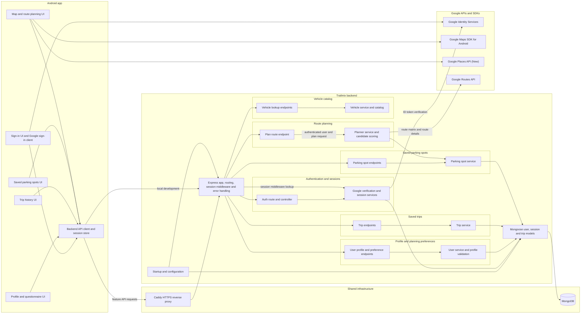

# Trailmix Dependency Diagram

The diagram groups components by the feature they support. Shared infrastructure and external providers are shown separately. Arrows indicate a dependency or request direction.

