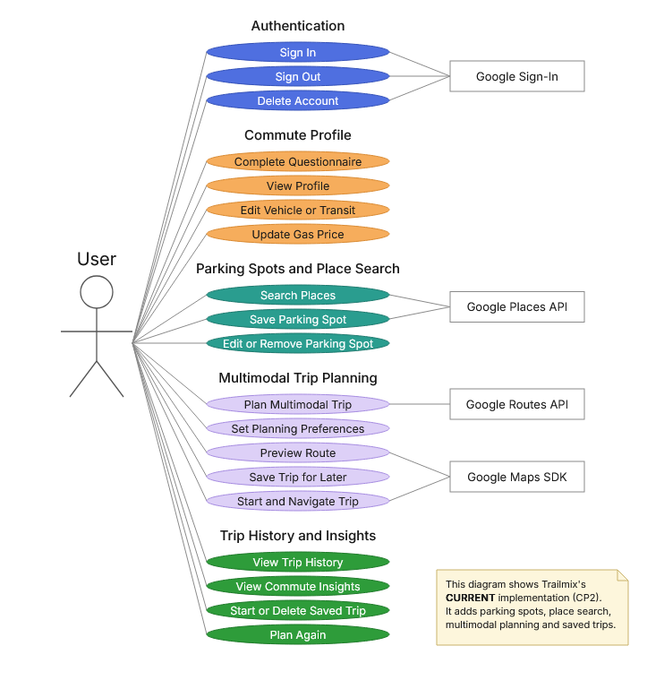
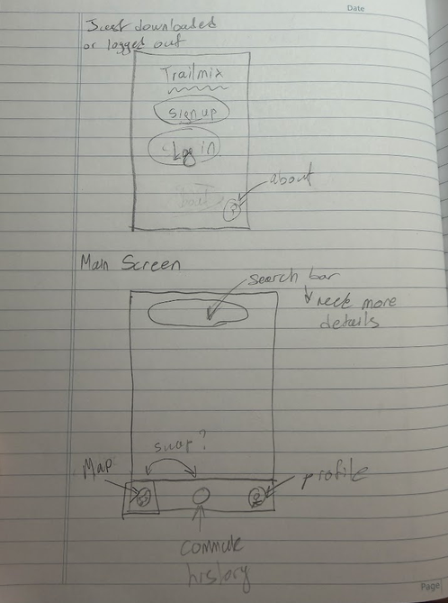
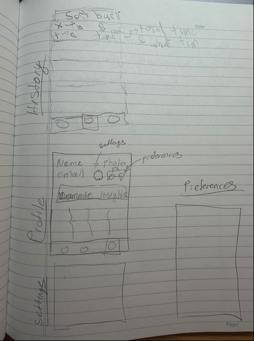
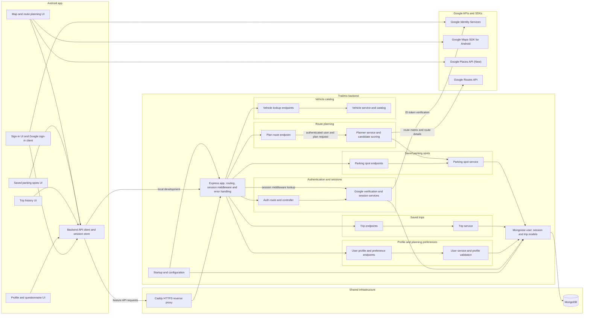
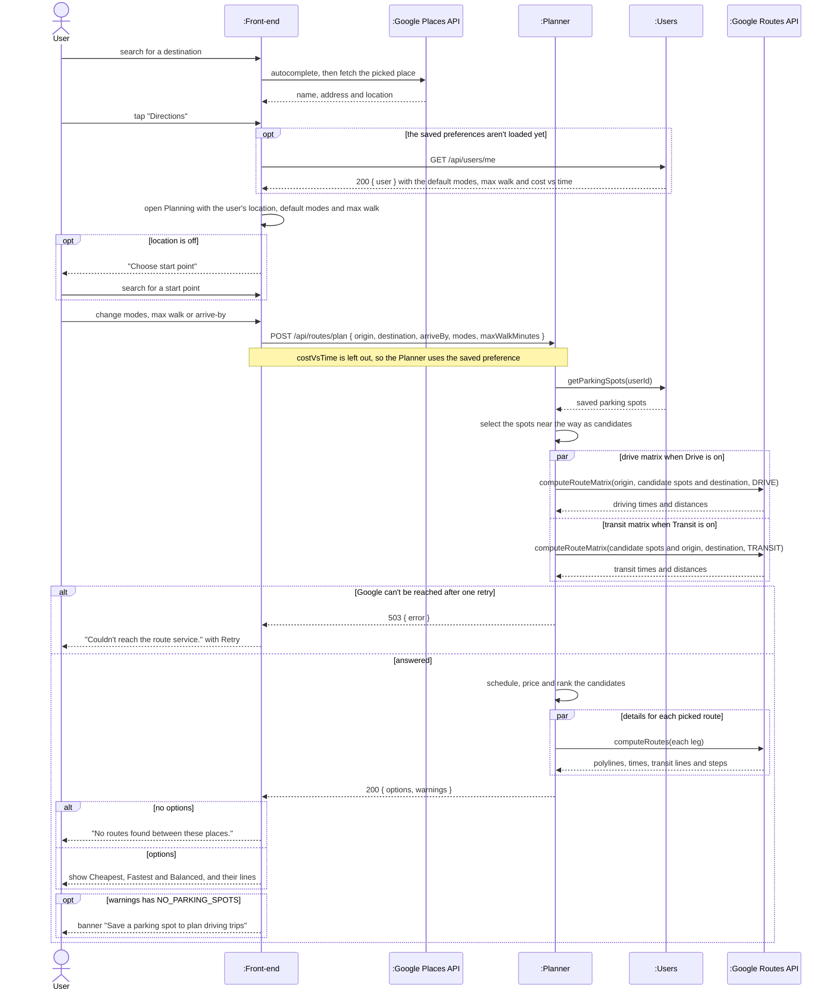
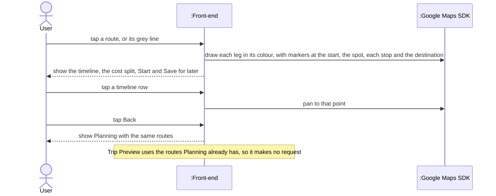
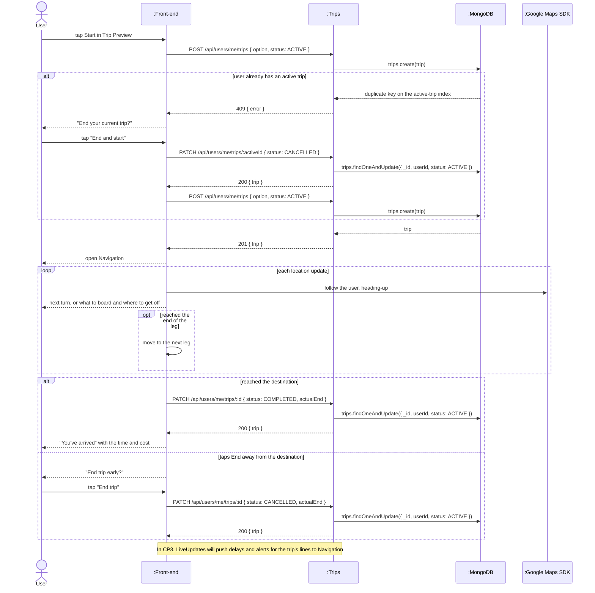
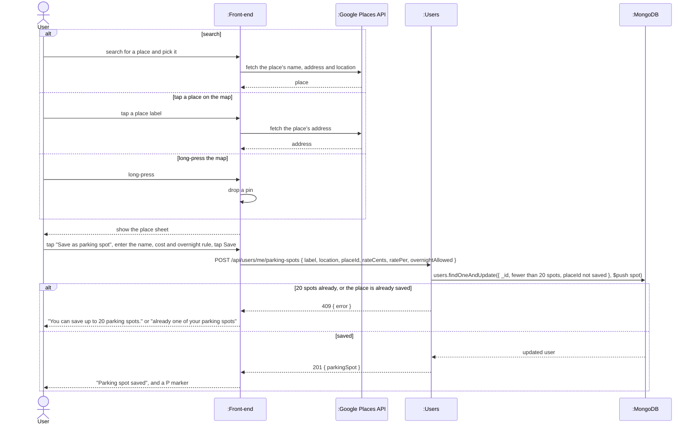
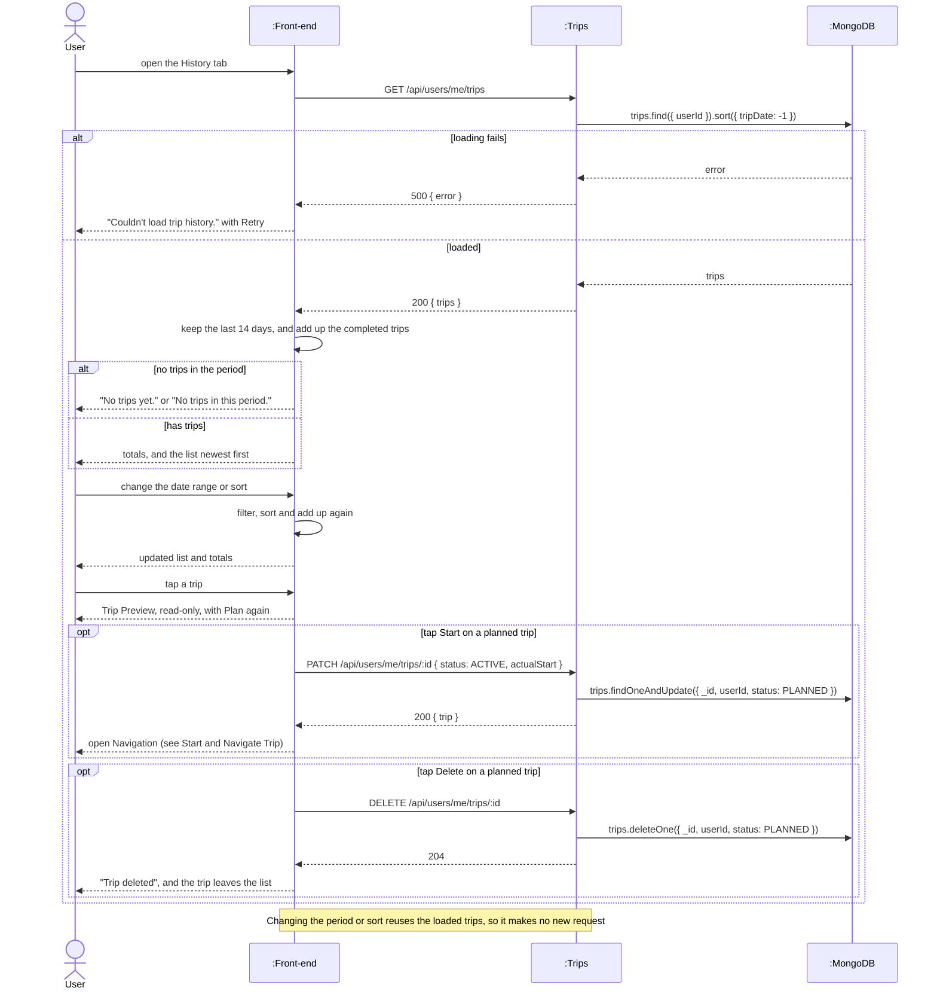

# Requirements and Design

## 1. Change History

| **Change Date**   | **Modified Sections** | **Rationale** |
| ----------------- | --------------------- | ------------- |
| Oct 15, 2026 | 4.2 | Added the MongoDB `users` and `sessions` collections for Google sign-in (#9). |
| Oct 16, 2026 | 4.2 | Added the commute profile fields to `users` for the questionnaire (#10). |
| Oct 19, 2026 | 2, 3, 4 | Filled in the project description, requirements, and design for sign-in, the commute questionnaire, chained commute planning, and trip history, and added the `trips` collection (#20). |
| Oct 19, 2026 | 3.6 | Added rough screen mock-ups for sign-in, the main screen, trip history, profile, settings, and preferences. |
| Oct 20, 2026 | 4.1, 4.2 | Added `POST /api/users/me/trips/seed` and the Map tab's "Load demo trips" button, so any user can fill History and Commute Insights on the release build. |
| Oct 20, 2026 | 3.2 | Added the use case diagram for the current implementation (CP1). |
| Nov 1, 2026 | 3.1, 4.1, 4.2, 4.3, 4.4 | Added parking spots and place search on the Map tab (#71): the parking spot endpoints, `parkingSpots` in `users`, the Places API, and the Places SDK for Android. Parking spots are the places the Planner (#72) will switch from driving to transit. |
| Nov 1, 2026 | 4.1, 4.2 | Removed `POST /api/users/me/trips/seed` and the Map tab's "Load demo trips" button, which isn't part of the app's features. Demo trips can still be added to a local database with `scripts/seed-trips`. |
| Nov 1, 2026 | 3.1, 4.3 | Places on the map can now be tapped to open their sheet, and the sheet can be closed, to match Google Maps (#71). The Places API also looks up a tapped place's address. |
| Nov 2, 2026 | 2, 3, 4.1, 4.2, 4.3 | Replaced the Routes component design with the multimodal Planner, and documented its plan and preferences endpoints (#72). |
| Nov 4, 2026 | 2, 3.1, 3.4 | The app now plans, previews, saves, starts and navigates trips, and History shows totals (#73, #74), so the description, features and use cases describe what is built instead of goals. Parking spots and trip navigation have their own features and use cases, and Delete Account and Edit Commute Details, which the app already had, are now listed. |
| Nov 4, 2026 | 3.2, 3.3, 3.4 | Updated the use case diagram, actors and use case descriptions to the current implementation (CP2): parking spots and place search, multimodal planning, and saving, starting and navigating trips. Added the Google Places API and Google Maps SDK as actors. |
| Nov 4, 2026 | 3.5, 4.6 | The 5 formal use cases are now Plan Multimodal Trip, Preview Route, Start and Navigate Trip, Save Parking Spot, and View Trip History, the team's 5 most central use cases. Sign In with Google was dropped from them because the course excludes authentication, and View Trip History and View Commute Insights were merged into View History and Totals. Each has a new sequence diagram. |
| Nov 4, 2026 | 3.7, 4.7 | The response time requirement now covers the Planner (95% of plans within 4 s, as `planner.response-time.test.ts` checks) instead of the old chained route, and describes how the Planner meets it. Added live-update latency as the CP3 requirement. |
| Nov 4, 2026 | 4.1 | Removed `POST /api/routes/chained`, since the app now calls the Planner and the endpoint was deleted (#72). Added the trip save, status change and delete endpoints (#74), `maxWalkMinutes` in the planning endpoints, a rationale for each component, and the internal interfaces the components call on each other. |
| Nov 4, 2026 | 4.2 | Documented the trips v2 fields (status, transfer points, planned and actual times, cost breakdown, and each leg's times and turn-by-turn steps) and the one-active-trip index (#74). A trip's total time can now be longer than its legs, since it includes waiting between them. |
| Nov 4, 2026 | 4.3, 4.4, 4.5 | Google Routes now also returns turn-by-turn steps, and Maps Compose is listed with the other libraries. The dependency diagram is redrawn in Mermaid for the CP2 components, grouped by feature with the Google APIs and SDKs the app and back-end use (#81). |
| Nov 4, 2026 | 3.1, 3.5, 4.3, 4.6 | Renamed use cases 3 and 5 to Start and Navigate Trip and View Trip History, and made Navigation part of Multimodal Trip Planning, to match the updated use case diagram. TransLink GTFS-Realtime is no longer listed as an actor or external module, since it isn't used until CP3, and LiveUpdates (4.1) still describes that plan. |
| Nov 4, 2026 | 4.6 | Added Timmy's sequence diagram updates (#83): Planning loads the saved preferences before the first plan and leaves `costVsTime` out, and History can start or delete a planned trip. |

---

## 2. Project Description

Trailmix is an Android app for **multimodal commuting** in Metro Vancouver. Many commuters drive part of the way, park, and take transit the rest, but map apps plan either driving or transit, never both. Trailmix plans both at once. The user saves the parking spots they are willing to use, picks a destination, and Trailmix compares driving the whole way, taking transit the whole way, and driving to one of their spots and taking transit from there.

The Planner schedules each route backward from an optional arrive-by time, prices it with the user's own car, gas price, parking rates and transit fare, and returns up to three routes labelled Cheapest, Fastest and Balanced. The user can preview a route, save it for later or start it, and Trailmix navigates every leg in the app. Finished trips go to History, which shows the time, distance and money spent over a period, and how much the user saved compared with driving.

---

## 3. Requirements Specification

### **3.1. List of Features**

1. **Authentication**: Sign in with Google, sign out, and delete the account.
2. **Commute Profile**: A first-time questionnaire about the user's car (make, model, fuel use) and transit fare type, which can be edited later from the Profile tab along with the last gas price paid. The Planner uses them to price trips.
3. **Parking Spots and Place Search**: Search for places on the Map tab, and save up to 20 parking spots (a name, an optional cost per hour or per day, and whether overnight parking is allowed) from search, by tapping a place on the map, or by long-pressing the map. Each place opens in a sheet like Google Maps', with Directions and Save as parking spot. Saved spots show as P markers, and are the only places the Planner switches from driving to transit.
4. **Multimodal Trip Planning**: From a place's Directions, choose the start, the allowed modes, the longest single walk, and Leave now or an arrive-by time, and get up to three routes (Cheapest, Fastest, Balanced) that the Planner schedules and prices. Each route opens in Trip Preview, with every leg on the map and a timeline, and can be saved for later or started. Starting a trip opens Navigation, which follows the user's location through each leg, showing the next turn on a drive or walk and what to board and where to get off on transit, and completes the trip at the destination. In CP3, live TransLink delays and alerts will update the active trip.
5. **Trip History and Insights**: View saved trips by date range and sort, start or delete planned ones, reopen a trip in Trip Preview to plan it again, and see the totals of completed trips (time, distance, cost, time by mode, and saved vs driving) and the commute insights for a period.

### **3.2. Use Case Diagram**

### **3.3. Actors Description**
1. **User**: A commuter using the app.
2. **Google Sign-In**: Authenticates the user.
3. **Google Routes API**: Provides driving and transit routes.
4. **Google Places API**: Suggests places as the user types, and gets the name, address and location of a picked or tapped place.
5. **Google Maps SDK**: Shows the map, route previews and turn-by-turn navigation, and reports taps and long-presses on the map.

### **3.4. Use Case Description**
- Use cases for feature 1: **Authentication**
1. **Sign In with Google**: The user signs in, and an account is created on first sign-in.
2. **Sign Out**: Ends the session on this device.
3. **Delete Account**: Permanently deletes the user's profile and trip history.
- Use cases for feature 2: **Commute Profile**
4. **Complete Questionnaire**: The user saves their car and transit details.
5. **View Profile**: Shows the user's vehicle, transit fare type and last gas price.
6. **Edit Vehicle or Transit**: The user changes their car or how they pay for transit.
7. **Update Gas Price**: The user sets the gas price (¢/L) used to estimate driving costs.
- Use cases for feature 3: **Planner**
8. **Plan Multimodal Trip**: The user picks a start, a destination, allowed modes, a max walk and an optional arrive-by time, and the Planner returns up to three priced and ranked route options.
9. **Set Planning Preferences**: Saves the user's default modes and max walk, so Planning starts from them.
10. **Preview Route**: Shows a route option on the map with its legs, times and cost.
11. **Save Trip for Later**: Saves the previewed route as a planned trip in History.
12. **Start and Navigate Trip**: Starts the route as the active trip and steps through it leg by leg. Arriving completes the trip, and ending early cancels it. Starting a new trip while one is active cancels the old one.
- Use cases for feature 4: **Parking Spots and Place Search**
13. **Search Places**: Suggests places as the user types on the Map tab, and opens the picked or tapped place in a sheet.
14. **Save Parking Spot**: Saves a place as a parking spot (up to 20) with a name, an optional cost per hour or per day, and whether overnight parking is allowed.
15. **Edit or Remove Parking Spot**: Changes a saved spot's details, or removes it.
- Use cases for feature 5: **Trip History and Insights**
16. **View Trip History**: Lists trips, filtered by date range and sorted by date or cost, with totals for completed trips.
17. **View Commute Insights**: Shows the average time, average cost and time by transportation for a chosen period.
18. **Start or Delete Saved Trip**: Starts a planned trip from History, or deletes it.
19. **Plan Again**: Opens a past trip's route in Planning with its places and modes.

### **3.5. Formal Use Case Specifications (5 Most Major Use Cases)**

#### Use Case 1: Plan Multimodal Trip

**Description**: The user picks a destination, start, modes, longest walk and arrive-by time, and the Planner returns up to three priced and ranked routes.

**Primary actor(s)**: User, Google Places API, Google Routes API

**Main success scenario**:
1. The user searches for a destination on the Map tab and taps **Directions** on its place sheet.
2. The app opens Planning, with the user's location as the start, the user's default modes and longest walk, and **Leave now**.
3. The user changes the start (by search), the modes, the longest walk, or sets **Arrive by** a time today or tomorrow.
4. The app sends the trip to the Planner, again each time the user stops changing it.
5. The Planner considers driving the whole way, transit the whole way, and driving to each nearby saved parking spot and taking transit from there, then schedules, prices and ranks them.
6. The app shows up to three routes labelled Cheapest, Fastest and Balanced, each with its leave and arrive times, cost, modes, and transfers, and draws them on the map.

**Failure scenario(s)**:
- 2a. Location is off or unknown.
    - 2a1. The start shows "Choose start point", and the app asks the user to choose one before planning.
- 5a. Drive is on, but the user has no saved parking spots.
    - 5a1. The app shows the banner "Save a parking spot to plan driving trips" above any routes, with **Back to map**, which returns to the destination's place sheet.
- 5b. Drive is on, but the user hasn't set their gas price or car.
    - 5b1. The app shows a banner to set them in Profile, and the costs use defaults.
- 5c. No route exists for any allowed mode.
    - 5c1. The app shows "No routes found between these places."
- 5d. Google Routes can't be reached, even after one retry.
    - 5d1. The app shows "Couldn't reach the route service." with **Retry**.

#### Use Case 2: Preview Route

**Description**: The user opens one route to see each leg on the map and the trip's timeline and costs, then goes back to the same routes.

**Primary actor(s)**: User

**Main success scenario**:
1. In Planning, the user taps a route, or its grey line on the map.
2. The app opens Trip Preview: each leg on the map in its own colour (driving blue, transit in its line's colour, walking dotted grey), and a timeline from **Leave** to **Arrive at** the destination, with each drive, parking spot, walk, boarding and stop, the cost split into fuel, parking and fare, and the **Start** and **Save for later** buttons.
3. The user taps a timeline row, and the map pans to that point.
4. The user taps Back, and the app returns to Planning with the same routes and arrive-by time, without planning again.

**Failure scenario(s)**:
- 2a. A transit line has no colour from Google.
    - 2a1. The app draws it in a fallback grey-blue.
- 2b. A parking spot's cost isn't known.
    - 2b1. The timeline shows "Parking cost unknown", and the route's cost is marked as an estimate.

#### Use Case 3: Start and Navigate Trip

**Description**: The user starts a route or a planned trip, and the app guides them through each leg until they arrive or end the trip.

**Primary actor(s)**: User

**Main success scenario**:
1. The user taps **Start** in Trip Preview, or on a planned trip in History.
2. The app saves the trip as active and opens Navigation, which the app also reopens if it is closed during the trip.
3. On a drive or walk leg, the top card shows the next turn and how far away it is. On a transit leg, it shows what to board, and once the user is riding, where to get off.
4. When the user reaches the end of a leg, the app moves to the next one.
5. When the user reaches the destination, the app completes the trip and shows "You've arrived" with its time and cost, until the user taps **Done**.
6. (CP3) When TransLink reports a delay or alert on one of the trip's lines, the app updates the trip's times and shows the alert.

**Failure scenario(s)**:
- 2a. The user already has an active trip.
    - 2a1. The app asks "End your current trip?". **End and start** cancels the current trip and starts the new one, and **Keep current trip** changes nothing.
- 2b. The trip can't be saved because there is no connection.
    - 2b1. The app shows "Couldn't update the trip. Check your connection and try again." and stays where it was.
- 3a. Location permission is off.
    - 3a1. The app shows each leg without the turns, and the user moves on with **Next leg**.
- 4a. GPS puts the user in the wrong place.
    - 4a1. The user taps **Next leg** to move on by hand.
- 5a. The user taps **End** away from the destination.
    - 5a1. The app asks "End trip early?". **End trip** cancels the trip, so it isn't counted in the totals, and **Keep going** returns to Navigation.

#### Use Case 4: Save Parking Spot

**Description**: The user saves a place, or a dropped pin, as a parking spot with a name, an optional cost and an overnight rule.

**Primary actor(s)**: User, Google Places API

**Main success scenario**:
1. The user searches for a place, taps a place on the map, or long-presses the map to drop a pin.
2. The app opens the place's sheet, and the user taps **Save as parking spot**.
3. The user enters a name, an optional cost per hour or per day, and whether overnight parking is not allowed, and taps **Save**.
4. The app saves the spot, shows "Parking spot saved", and draws a P marker on the map.

**Failure scenario(s)**:
- 3a. The name is blank or the cost is invalid.
    - 3a1. The app marks the field, and **Save** stays disabled.
- 4a. The user already has 20 parking spots.
    - 4a1. The app shows "You can save up to 20 parking spots. Remove one first."
- 4b. The place is already one of the user's spots.
    - 4b1. The app shows "This place is already one of your parking spots."
- 4c. There is no connection.
    - 4c1. The app shows "Couldn't save. Check your connection and try again." and keeps the dialog open.

#### Use Case 5: View Trip History

**Description**: The user lists their trips for a date range and sort, and sees the totals of the completed ones.

**Primary actor(s)**: User

**Main success scenario**:
1. The user opens the History tab.
2. The app lists the trips of the last 14 days, newest first, each with its places, date, modes, time and cost.
3. Above the list, the app shows the totals of the period's completed trips: the time, distance and cost, the time by mode (including waiting), and how much the user saved compared with driving.
4. The user changes the date range or the sort, and the list and totals update.
5. The user taps a trip, and the app opens it read-only in Trip Preview, with **Plan again**.

**Failure scenario(s)**:
- 2a. The user has no trips, or none in the period.
    - 2a1. The app shows "No trips yet." or "No trips in this period."
- 2b. Loading fails.
    - 2b1. The app shows "Couldn't load trip history. Check your connection and try again." with **Retry**.
- 3a. None of the period's trips were completed.
    - 3a1. The totals show "No completed trips in this period."
- 5a. The trip was saved before CP2, without the details Trip Preview needs.
    - 5a1. The trip can't be opened, and stays in the list.

### **3.6. Screen Mock-ups**

These are the rough hand-drawn sketches from CP1. The built screens follow Google Maps' layout instead (a full-screen map with a bottom sheet), so the sketches only show the first plan for the tabs.

1. **Sign-in**: Shown when the app is first downloaded or the user is signed out, with Sign up, Log in, and an About button.
2. **Main screen**: A map with a search bar and a bottom bar for Map, Trip history, and Profile.

3. **Trip history**: A sort bar and a list of trips, each showing the route, total time, and wait time.
4. **Profile**: The user's name, email, and photo, buttons for Settings and Preferences, and a Commute insights section.
5. **Settings** and **Preferences**: Separate screens opened from Profile, not designed yet.

### **3.7. Non-Functional Requirements**

1. **Planning Response Time**
   - **Description**: The Planner returns its routes within 4 seconds for 95% of requests.
   - **Justification**: Users plan right before they leave, often comparing a few arrive-by times, so planning must feel quick. One plan makes two rounds of Google Routes calls (screening the candidates, then the details of the picked routes), so 4 s leaves room for both while staying well under the 10 s after which users lose focus on a task ([Nielsen, "Response Times: The 3 Important Limits"](https://www.nngroup.com/articles/response-times-3-important-limits/)).

2. **Security**
   - **Description**: In production, all traffic uses HTTPS, and every request for user data requires a valid session for that user.
   - **Justification**: Saved parking spots and trips reveal where users live and work, and when they are away from home.

3. **Live Update Latency (CP3)**
   - **Description**: A TransLink delay or alert on one of the active trip's lines reaches the app within 60 seconds of TransLink publishing it.
   - **Justification**: A rider deciding whether to wait for a delayed bus or walk needs to hear about the delay while the choice still matters. On TransLink's Frequent Transit Network a bus comes at least every 15 minutes, so a delay that arrives within a minute still leaves time to choose.

---

## 4. Designs Specification
### **4.1. Main Components**

Every request except sign-in first passes Auth's `requireSession`, which finds the session and the user it belongs to. Components only ever read or change the signed-in user's data.

1. **Auth**
   - **Purpose**: Google sign-in and sessions.
   - **Rationale**: Kept apart from Users because one user can be signed in on several devices, and the session check runs on every request. We verify Google ID tokens ourselves with `google-auth-library` rather than using a hosted auth service, which the course doesn't allow.
   - **Interfaces**:
       1. `POST /api/auth/google { idToken }` → `{ sessionToken, user }`
           - **Purpose**: Verifies the Google ID token, creates the account on first sign-in, and creates a session.
       2. `POST /api/auth/sign-out` → `204 No Content`
           - **Purpose**: Ends this device's session.
       3. `Session findSessionByToken(String token)` (internal, used by `requireSession`)
           - **Purpose**: Finds the session for a token by its SHA-256 hash, or returns `null`.
       4. `void deleteUserSessions(ObjectId userId)` (internal, called by Users)
           - **Purpose**: Signs out every device when the account is deleted.
2. **Users**
   - **Purpose**: The account, commute profile, planning preferences and parking spots.
   - **Rationale**: These are all per-user settings that are read together on every plan, so they live in one user document and one component.
   - **Interfaces**:
       1. `GET /api/users/me` → `{ user }`
           - **Purpose**: Gets the signed-in user, including their profile and planning preferences.
       2. `PUT /api/users/me/profile { timezone, vehicle, transit }` → `{ user }`
           - **Purpose**: Saves the questionnaire answers.
       3. `GET /api/vehicles/makes`, `GET /api/vehicles/makes/:make/models` → `{ makes }`, `{ models }`
           - **Purpose**: Gets the car options for the questionnaire.
       4. `PUT /api/users/me/gas-price { centsPerLitre }` → `{ user }`
           - **Purpose**: Saves the last gas price a driver entered on the Profile tab.
       5. `PUT /api/users/me/planning-preferences { costVsTime, defaultModes, maxWalkMinutes? }` → `{ user }`
           - **Purpose**: Saves the user's default cost-versus-time preference (0–100), allowed modes, and longest single walk (1–60 minutes, default 10).
       6. `DELETE /api/users/me` → `204 No Content`
           - **Purpose**: Deletes the account with its parking spots, trips and sessions.
       7. `GET /api/users/me/parking-spots` → `{ parkingSpots }`
           - **Purpose**: Gets the user's parking spots, newest first, for the Map tab's P markers.
       8. `POST /api/users/me/parking-spots { label, location, placeId?, rateCents?, ratePer?, overnightAllowed? }` → `201 { parkingSpot }`
           - **Purpose**: Saves a parking spot from search, a tapped place, or a dropped pin. Returns `409` when the user already has 20 spots or already saved the same `placeId`.
       9. `PUT /api/users/me/parking-spots/:id { label, rateCents?, ratePer?, overnightAllowed? }` → `{ parkingSpot }`
           - **Purpose**: Edits a spot's name, cost and overnight rule from the place sheet. The spot's place can't change.
       10. `DELETE /api/users/me/parking-spots/:id` → `204 No Content`
           - **Purpose**: Removes a parking spot. Another user's or an unknown spot returns `404`.
       11. `User upsertGoogleUser(GoogleProfile profile)` (internal, called by Auth)
           - **Purpose**: Creates the account on first sign-in, and refreshes the name, email and photo on every sign-in.
       12. `List<ParkingSpot> getParkingSpots(ObjectId userId)` (internal, called by the Planner)
           - **Purpose**: Gives the Planner the user's parking spots, the only places a trip can switch from driving to transit.
3. **Planner**
   - **Purpose**: Multimodal trip planning. Choosing the parking spots to try, scheduling, pricing and ranking are our own logic, and Google only supplies travel times and route details.
   - **Rationale**: Neither Google Maps nor Google Routes plans a drive-then-transit trip through the user's own parking spots, so this is the part of Trailmix that has to be ours. It is a separate component because it calls Google and does no database writes.
   - **Interfaces**:
       1. `POST /api/routes/plan { origin, destination, arriveBy, modes, costVsTime?, maxWalkMinutes? }` → `{ options, warnings }`
           - **Purpose**: Returns up to three distinct routes labelled Cheapest, Fastest and Balanced. It considers driving and transit the whole way and Drive → Transit through the user's saved parking spots, uses the user's costs and saved preferences unless the request overrides them, and schedules backward from `arriveBy` when it is given. `warnings` can hold `NO_PARKING_SPOTS`, `GAS_PRICE_MISSING` and `VEHICLE_MISSING`. Returns `503` when Google Routes can't be reached after one retry.
4. **Trips**
   - **Purpose**: Saved trips and their lifecycle (planned, active, completed or cancelled).
   - **Rationale**: Kept apart from Users because a user has many trips, and History lists them on their own.
   - **Interfaces**:
       1. `GET /api/users/me/trips` → `{ trips }`
           - **Purpose**: Gets the user's trips, newest first, for History and Navigation.
       2. `POST /api/users/me/trips { option, status, arriveBy?, actualStart? }` → `201 { trip }`
           - **Purpose**: Saves a route from Trip Preview as a `PLANNED` trip (Save for later) or an `ACTIVE` one (Start). Returns `409` if the user already has an active trip.
       3. `PATCH /api/users/me/trips/:id { status, actualStart?, actualEnd? }` → `{ trip }`
           - **Purpose**: Starts a planned trip (`ACTIVE`), or ends the active one as `COMPLETED` or `CANCELLED`. Returns `409` if the trip can't move to that status, or starting it would make a second active trip.
       4. `DELETE /api/users/me/trips/:id` → `204 No Content`
           - **Purpose**: Deletes a planned trip. Started and finished trips can't be deleted, so they stay in the totals.
       5. `void deleteUserTrips(ObjectId userId)` (internal, called by Users)
           - **Purpose**: Deletes every trip of an account that is being deleted.
5. **LiveUpdates (CP3, not built yet)**
   - **Purpose**: Will read TransLink's GTFS-Realtime feed and push delays and alerts for the active trip's lines to the app. Its interfaces will be added when it is built in CP3.

### **4.2. Databases**
1. **MongoDB (`mongo:7.0`)**
    - **Purpose**: Stores Trailmix's accounts, saved trips, and sign-in sessions. It runs as a container next to the backend on the VM and is reachable only over the private docker compose network. Its data lives in the `mongo-data` volume, so it survives restarts, rebuilds, and deploys.
    - **`users` collection**: one document per account, with `googleId` (Google's account ID), `email`, `name`, `photoUrl`, `profileComplete`, `timezone`, `vehicle`, `transit`, `lastGasPrice`, `parkingSpots`, `costVsTime`, `defaultModes`, `maxWalkMinutes`, `createdAt`, and `updatedAt`.
        - A **unique index on `googleId`** identifies users by the Google ID, which never changes, rather than by email, which can. The index also makes the database refuse a second account for the same Google account, even when two first sign-ins arrive at once.
        - The email, name, and photo are refreshed from Google on every sign-in.
        - The commute questionnaire adds `timezone`, `vehicle` (`make`, `model`, `colour`, `litresPer100km`, or `null` if the user doesn't drive), and `transit` (`fareType`, `monthlyPassZones`, or `null` if the user doesn't take transit). They sit inside the user document because there's only one of each and they're always loaded with the user. Only the fare type is stored, not the price, since fares change every year. Submitting the questionnaire replaces all three and sets `profileComplete`.
        - `lastGasPrice` (`centsPerLitre` and `savedAt`, or `null` until the user saves one) is the last gas price a driver entered on the Profile tab. The price must be 50.0–400.0 ¢/L with at most one decimal. The server sets `savedAt`, so the date can't be faked by the phone's clock. Only the latest price is kept, since only the latest is used to estimate driving costs.
        - `parkingSpots` holds at most 20 spots, newest first. Each has its own `_id` (used to edit and delete it), a `label` (1–60 characters), a `location` (`lat`, `lng`), a `placeId` (the Google place it came from, or `null` for a dropped pin), the cost as entered (`rateCents` and `ratePer` of `HOUR` or `DAY`, both `null` when unknown), `overnightAllowed`, and `createdAt`. They live inside the user document like `vehicle` and `transit`, because there are few of them, they belong to one user, and the Planner loads them with the profile. The 20-spot cap keeps the Planner's candidate list, and its Google API cost, bounded. The limit and the duplicate `placeId` check are part of the save's update filter, so two saves at once can't break either rule.
        - `costVsTime` is an integer from 0 to 100 (default 50), `defaultModes` is a non-empty subset of `DRIVE` and `TRANSIT` (default both), and `maxWalkMinutes` is the longest single walk a planned route may have, from 1 to 60 minutes (default 10). `GET /api/users/me` returns all three, and `PUT /api/users/me/planning-preferences` saves them.
        - Deleting an account (`DELETE /api/users/me`) removes the user document, and with it the parking spots, first, then every trip and every session for that `userId`, so the trip history is gone and every device the user was signed in on is signed out. Signing in again with the same Google account creates a new, empty account.
        - The car makes and models the questionnaire offers come from `backend/src/data/vehicles.json`, a hand-picked list in the repo loaded once at startup, not from the database.
    - **`trips` collection**: one document per saved trip, with `userId`, `status`, `origin`, `destination`, `transferPoints`, `legs`, `totalDurationSeconds`, `totalDistanceMeters`, `totalCostCents`, `costBreakdown`, `costEstimated`, `baselineDriveCostCents`, `arriveBy`, `plannedStart`, `plannedEnd`, `actualStart`, `actualEnd`, `tripDate`, `seeded`, `createdAt`, and `updatedAt`.
        - `status` is `PLANNED` (saved for later), `ACTIVE` (being travelled), `COMPLETED` or `CANCELLED`. A trip can only move from `PLANNED` to `ACTIVE`, and from `ACTIVE` to `COMPLETED` or `CANCELLED`, and only `PLANNED` trips can be deleted. The server sets `actualStart` and `tripDate` when a trip starts and `actualEnd` when it ends, and a trip can't end before it started. The current status is part of each change's update filter, so two changes at once can't both win.
        - Each place has a `label`, `lat`, `lng`, and optional `placeId`. `transferPoints` holds the parking spot of a Drive → Transit trip, and is empty otherwise.
        - Each leg has a `mode` (`DRIVE`, `TRANSIT` or `WALK`), its `from` and `to` places, `departAt` and `arriveAt`, `durationSeconds`, `distanceMeters`, `costCents`, an encoded `polyline`, the `transitLines` it rides (each with its name, short name such as "99", vehicle, colour, headsign, stops and stop count), and the turn-by-turn `steps` of a drive or walk (each with Google's instruction, maneuver and location), which Navigation shows.
        - The total cost and distance must equal the sum of the legs, and the cost breakdown (fuel, parking and fare) must add up to the total cost. The total time runs from leaving to arriving, so it can be longer than the legs, because it includes waiting between them (like waiting for a bus).
        - Trips are kept separate from users because a user has many, and the History tab lists them on their own. A compound **index on `userId` and `tripDate` (newest first)** makes `GET /api/users/me/trips` one indexed lookup that is already sorted. A **unique partial index on `userId` for `ACTIVE` trips** makes the database refuse a second active trip, even when two starts arrive at once.
        - Trips saved before CP2 have a `midpoint` instead of `transferPoints` and no leg times, so they still show in History but can't be opened in Trip Preview.
        - The app never sees `userId`, `seeded` (marks demo trips added by `scripts/seed-trips`), or the timestamps. The History tab filters and sorts the trips and computes the totals and commute insights on the phone.
    - **`sessions` collection**: one document per signed-in device, with `tokenHash`, `userId`, and `createdAt`.
        - The app holds a random 256-bit token. Only its SHA-256 hash is stored (with a **unique index**), so a leaked database can't be used to sign in, and finding a session is one indexed lookup.
        - Sessions are kept separate from users so one user can be signed in on several devices, and signing out deletes only that device's session.
        - Sessions never expire on their own. A session ends when its device signs out, or when the account is deleted (`userId` is **indexed** so every session for the account can be removed at once). A session whose account no longer exists is rejected.

### **4.3. External Modules**
1. **Google Sign-In**
- **Purpose**: Authenticates users. The app gets an ID token through Android's Credential Manager, and Auth verifies it.
2. **Google Routes API**
- **Purpose**: The Planner screens candidate routes with Route Matrix (`computeRouteMatrix`), then gets the picked routes' leg times, geometry, transit line details and turn-by-turn steps with `computeRoutes`. The backend retries each call once after an error or a 10 s timeout. Transit fare zones use a small SkyTrain station table: buses count as one zone, unknown rail endpoints default to one zone, and fares don't yet adjust for evening and weekend one-zone travel or the YVR AddFare.
- **Rationale**: Google's transit data covers TransLink's schedule, and Route Matrix times many candidates in one call, where requesting each route separately would take more calls and more time.
3. **Google Maps SDK**
- **Purpose**: Displays the map and routes, and reports taps on its place labels (with their Google place IDs) and long-presses.
4. **Google Places API (New)**
- **Purpose**: Suggests places as the user types on the Map tab, biased to Metro Vancouver, and gets the name, address and location of the one they pick, or the address of a place label tapped on the map. Called from the app with a key restricted to the app's package and signing certificate.

### **4.4. Frameworks and Libraries**
1. **Kotlin + Jetpack Compose**
   - **Purpose**: Android UI.
   - **Reason**: Course requirement.
2. **Node.js + TypeScript + Express**
   - **Purpose**: Backend server.
   - **Reason**: Course requirement. Types catch errors early.
3. **Mongoose**
   - **Purpose**: MongoDB access and validation.
   - **Reason**: Typed schemas and indexes.
4. **Docker + Caddy (GCP VM)**
   - **Purpose**: Deployment and HTTPS.
   - **Reason**: Caddy renews HTTPS certificates automatically.
5. **Navigation Compose (`androidx.navigation:navigation-compose`)**
   - **Purpose**: Moves between the screens after sign-in: the Map, History (trip history and commute insights), and Profile tabs of the nav bar, and the Edit vehicle and Edit transit screens opened from Profile. It keeps each tab's back stack and scroll position when the user switches tabs, and makes Back on any tab return to Map.
   - **Reason**: It is the official Jetpack library for navigating between Compose screens. Writing our own back stack would mean re-implementing saving and restoring each tab's state across tab switches and screen rotation.
6. **Maps Compose (`com.google.maps.android:maps-compose`)**
   - **Purpose**: Shows the Google map, the P markers, and the routes' lines on the Map tab and in Planning, Trip Preview and Navigation.
   - **Reason**: It is Google's official Compose wrapper for the Maps SDK, so the map is a composable like the rest of the UI instead of an Android View we would have to bridge ourselves.
7. **Places SDK for Android (`com.google.android.libraries.places:places`)**
   - **Purpose**: The Map tab's search suggestions (Autocomplete New) and the picked place's details.
   - **Reason**: It is Google's official client for the Places API, and handles session tokens so suggestions and the picked place are billed as one search. Version 4.1.0 is the newest that builds with the project's pinned toolchain (compileSdk 35, Kotlin 2.1).

### **4.5. Dependencies Diagram**

The diagram groups components by the feature they support. Shared infrastructure and external providers are shown separately. Arrows indicate a dependency or request direction.

> **Note:** The diagram is too wide to show inline on GitHub. Click the expand button (↔) at the top right of the diagram box to view it full screen.

### **4.6. Use Case Sequence Diagram (5 Most Major Use Cases)**

Each request below first passes Auth's `requireSession`, which is left out of the diagrams to keep them readable.

1. [**Plan Multimodal Trip**](#uc1)

2. [**Preview Route**](#uc2)

3. [**Start and Navigate Trip**](#uc3)

4. [**Save Parking Spot**](#uc4)

5. [**View Trip History**](#uc5)

### **4.7. Design of Non-Functional Requirements**
1. [**Planning Response Time**](#nfr1)
   - **Implementation**: The Planner only tries the 8 saved parking spots closest to the straight line from start to destination (and only those that add at most 40% to the distance), and screens all of them with two Route Matrix calls, one for driving and one for transit, made in parallel, instead of one route request per spot. It then gets the details of only the up to three routes it picks, also in parallel. Each Google call times out after 10 s and is retried once.
2. [**Security**](#nfr2)
   - **Implementation**: Caddy is the only public entry point and serves HTTPS. Session tokens are 256-bit random values stored only as SHA-256 hashes, every user-data endpoint goes through `requireSession`, and every query is filtered by the signed-in user's ID, so one user can't read or change another's spots or trips.
3. [**Live Update Latency (CP3)**](#nfr3)
   - **Implementation**: To be designed with LiveUpdates in CP3.
