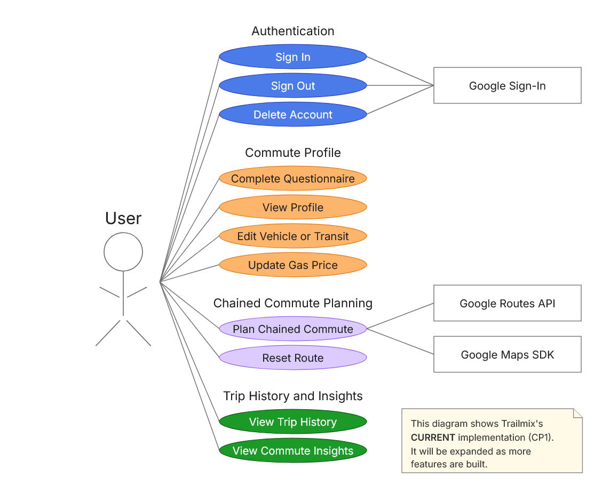
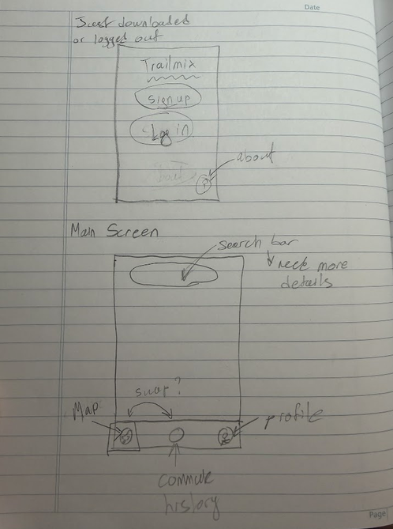
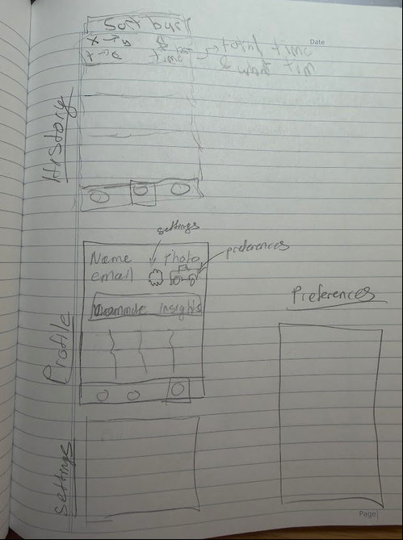
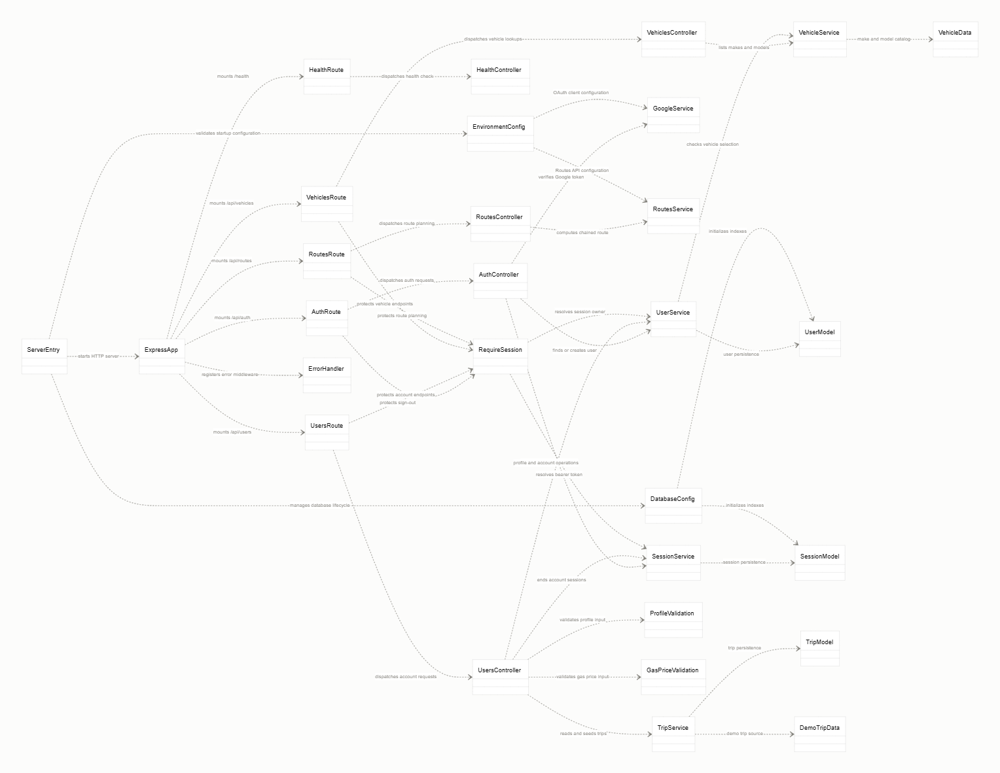
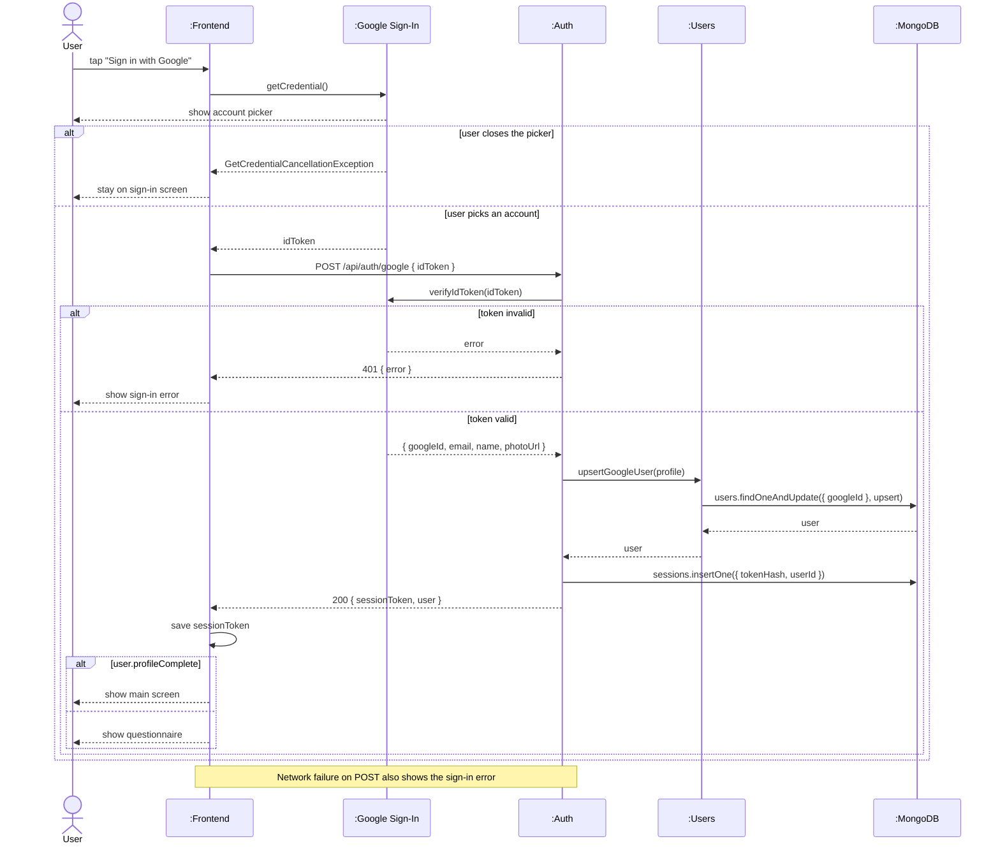
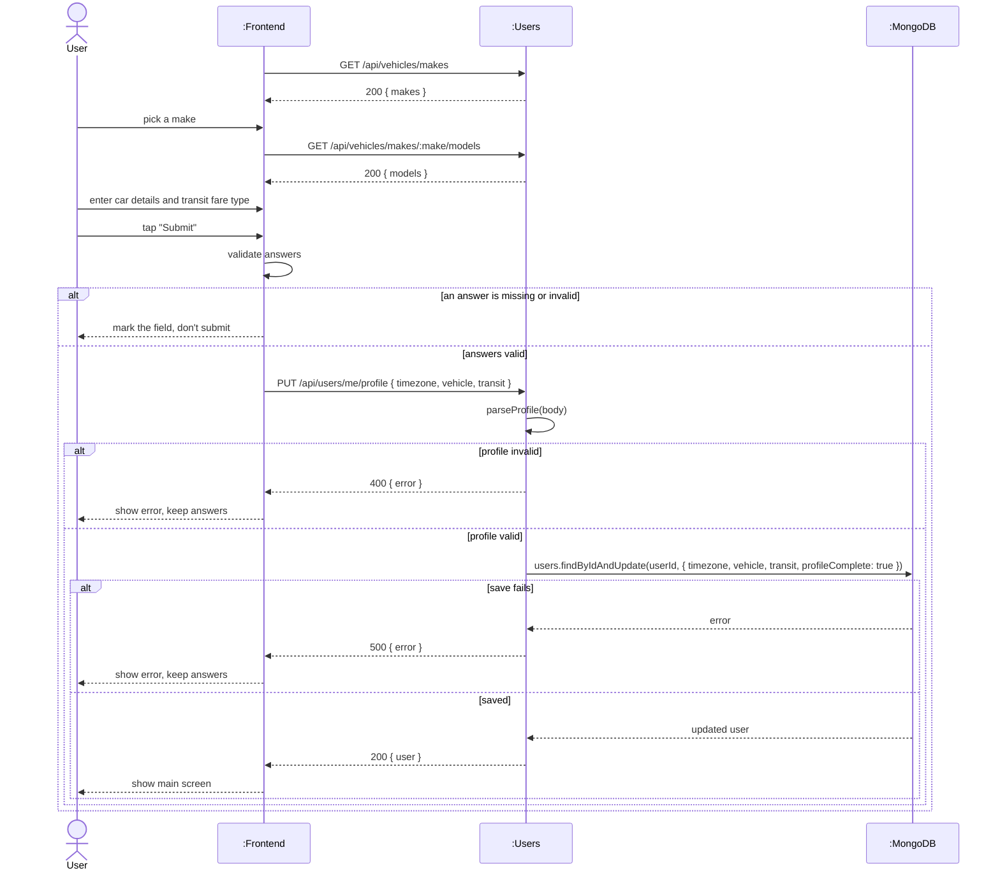
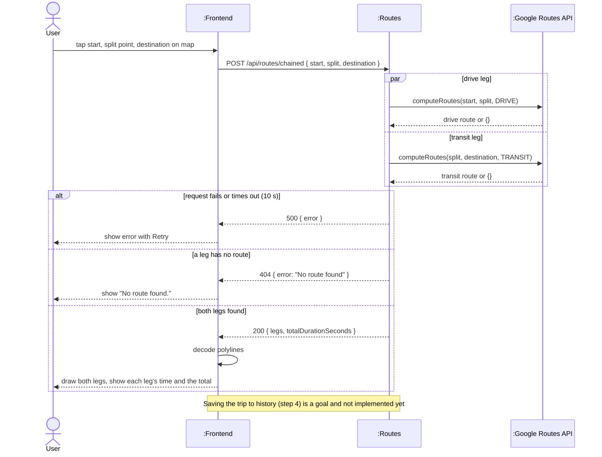
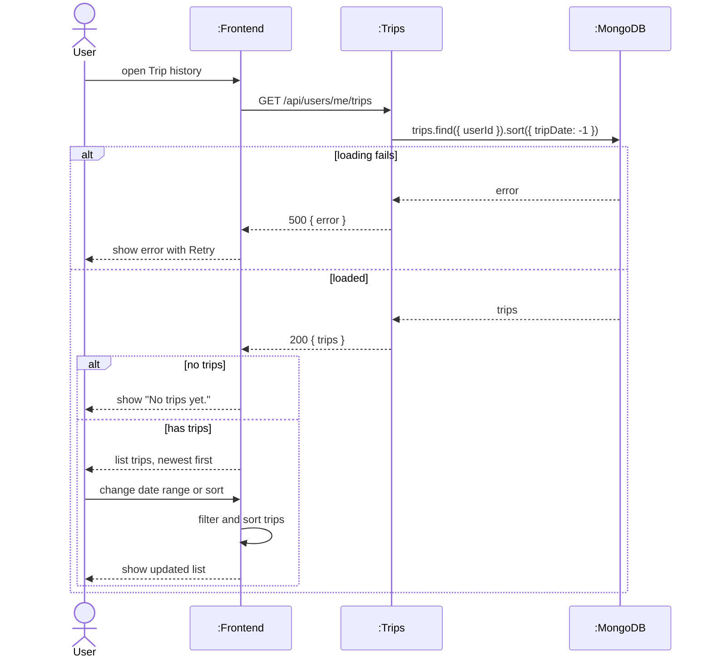
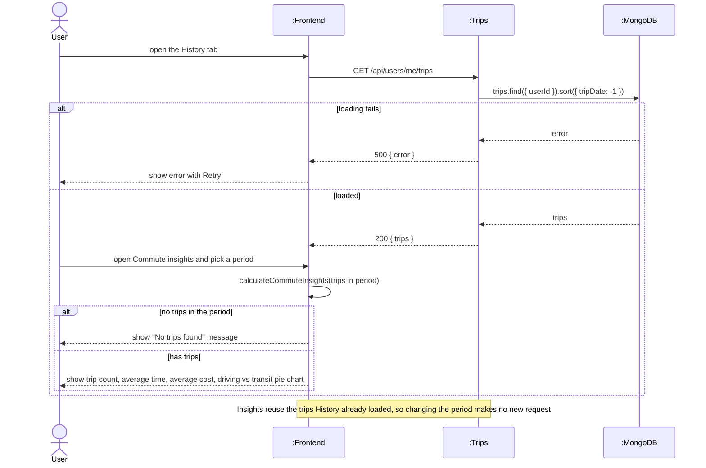

# Requirements and Design

## 1. Change History

| **Change Date**   | **Modified Sections** | **Rationale** |
| ----------------- | --------------------- | ------------- |
| Oct 15, 2026 | 4.2 | Added the MongoDB `users` and `sessions` collections for Google sign-in (#9). |
| Oct 16, 2026 | 4.2 | Added the commute profile fields to `users` for the questionnaire (#10). |
| Oct 19, 2026 | 2, 3, 4 | Filled in the project description, requirements, and design for sign-in, the commute questionnaire, chained commute planning, and trip history, and added the `trips` collection (#20). |
| Oct 19, 2026 | 3.6 | Added rough screen mock-ups for sign-in, the main screen, trip history, profile, settings, and preferences. |
| Oct 20, 2026 | 4.1, 4.2 | Added `POST /api/users/me/trips/seed` and the Map tab's "Load demo trips" button, so any user can fill History and Commute Insights on the release build. |
| Oct 20, 2026 | 3.2 | Added the use case diagram for the current implementation (CP1). |
| Nov 1, 2026 | 3.1, 4.1, 4.2, 4.3, 4.4 | Added parking spots and place search on the Map tab (#71): the parking spot endpoints, `parkingSpots` in `users`, the Places API, and the Places SDK for Android. Parking spots are the places the Planner (#72) will switch from driving to transit. |
| Nov 1, 2026 | 4.1, 4.2 | Removed `POST /api/users/me/trips/seed` and the Map tab's "Load demo trips" button, which isn't part of the app's features. Demo trips can still be added to a local database with `scripts/seed-trips`. |
| Nov 1, 2026 | 3.1, 4.3 | Places on the map can now be tapped to open their sheet, and the sheet can be closed, to match Google Maps (#71). The Places API also looks up a tapped place's address. |

---

## 2. Project Description

Trailmix is an Android app for **chained commutes**: driving partway, then taking transit from a split point. Regular map apps plan one travel mode per trip, so they can't plan "drive to the station, then take the SkyTrain." Trailmix plans both legs together, personalizes trip costs to the user's car and transit fare (goal), and saves each trip to a history with time and cost insights (goal: saving planned trips).

---

## 3. Requirements Specification

### **3.1. List of Features**

1. **Authentication**: Sign in with Google and sign out.
2. **Commute Profile**: A first-time questionnaire about the user's car (make, model, fuel use) and transit fare type. It will be used to estimate trip costs (goal).
3. **Chained Commute Planning**: Pick a start, split point, and destination on a map, and get a drive leg plus a transit leg with their times. Trailmix will choose the split point automatically (goal).
4. **Parking Spots and Place Search**: Search for places on the Map tab, and save up to 20 parking spots (a name, an optional cost per hour or per day, and whether overnight parking is allowed) from search, by tapping a place on the map, or by long-pressing the map. Each place opens in a sheet like Google Maps', which closes with its X, a tap on the map, a swipe down, or Back. Saved spots show as P markers, and are where a planned trip will switch from driving to transit (goal).
5. **Trip History and Insights**: View past trips by date and cost, and see average time, average cost, and driving vs transit time. Planned trips will be saved here automatically (goal).

### **3.2. Use Case Diagram**

### **3.3. Actors Description**
1. **User**: A commuter using the app.
2. **Google Sign-In**: Authenticates the user.
3. **Google Routes API**: Provides driving and transit routes.

### **3.4. Use Case Description**
- Use cases for feature 1: **Authentication**
1. **Sign In with Google**: The user signs in, and an account is created on first sign-in.
2. **Sign Out**: Ends the session on this device.
- Use cases for feature 2: **Commute Profile**
3. **Complete Questionnaire**: The user saves their car and transit details.
- Use cases for feature 3: **Chained Commute Planning**
4. **Plan Chained Commute**: The user sets three points and sees the drive and transit legs.
5. **Reset Route**: Clears the points and route.
- Use cases for feature 4: **Trip History and Insights**
6. **View Trip History**: Lists trips, filtered by date range and sorted by date or cost.
7. **View Commute Insights**: Shows the stats for a chosen period.

### **3.5. Formal Use Case Specifications (5 Most Major Use Cases)**

#### Use Case 1: Sign In with Google

**Description**: The user signs in to Trailmix.

**Primary actor(s)**: User, Google Sign-In
  
**Main success scenario**:
1. The user taps "Sign in with Google" and picks an account.
2. The backend verifies the Google token and creates a session.
3. The app shows the questionnaire (if the profile isn't finished) or the main screen.

**Failure scenario(s)**:
- 1a. The user closes the account picker.
   - 1a1. The app stays on the sign-in screen.

- 2a. The token is invalid or the network fails.
   - 2a1. The app shows a sign-in error.

#### Use Case 2: Complete Questionnaire

**Description**: The user saves their driving and transit details.

**Primary actor(s)**: User
  
**Main success scenario**:
1. The user enters their car details (if they drive) and transit fare type.
2. The user taps "Submit".
3. The backend validates and saves the answers. The app shows the main screen.

**Failure scenario(s)**:
- 2a. An answer is missing or invalid.
   - 2a1. The app marks the field and doesn't submit.

- 3a. The save fails.
   - 3a1. The app shows an error and keeps the answers.

#### Use Case 3: Plan Chained Commute

**Description**: The user plans a drive-then-transit trip.

**Primary actor(s)**: User, Google Routes API
  
**Main success scenario**:
1. The user taps the start, split point, and destination on the map.
2. The backend gets the drive and transit legs from the Routes API.
3. The app draws both legs and shows each leg's time and the total.
4. The trip is saved to the user's history (goal).

**Failure scenario(s)**:
- 2a. There is no route for a leg.
   - 2a1. The app shows "No route found."

- 2b. The request fails or times out.
   - 2b1. The app shows an error with Retry.

#### Use Case 4: View Trip History

**Description**: The user browses past trips.

**Primary actor(s)**: User
  
**Main success scenario**:
1. The user opens Trip history.
2. The app lists trips, newest first.
3. The user changes the date range or sort.

**Failure scenario(s)**:
- 2a. There are no trips.
   - 2a1. The app shows "No trips yet."

- 2b. Loading fails.
   - 2b1. The app shows an error with Retry.

#### Use Case 5: View Commute Insights

**Description**: The user sees a summary of their commuting.

**Primary actor(s)**: User
  
**Main success scenario**:
1. The user opens Commute insights and picks a period.
2. The app shows the trip count, average time, average cost, and a driving vs transit pie chart.

**Failure scenario(s)**:
- 2a. There are no trips in the period.
   - 2a1. The app shows a "No trips found" message.

- 2b. Loading fails.
   - 2b1. The app shows an error with Retry.

### **3.6. Screen Mock-ups**

These are rough hand-drawn sketches of the planned layout, and the details will change.

1. **Sign-in**: Shown when the app is first downloaded or the user is signed out, with Sign up, Log in, and an About button.
2. **Main screen**: A map with a search bar (details still to be decided) and a bottom bar for Map, Trip history, and Profile.

3. **Trip history**: A sort bar and a list of trips, each showing the route, total time, and wait time.
4. **Profile**: The user's name, email, and photo, buttons for Settings and Preferences, and a Commute insights section.
5. **Settings** and **Preferences**: Separate screens opened from Profile, not designed yet.

### **3.7. Non-Functional Requirements**

1. **Response Time**
   - **Description**: A chained route is returned within 3 seconds.
   - **Justification**: Users compare split points before leaving, so planning must feel quick.

2. **Security**
   - **Description**: In production, all traffic uses HTTPS, and all user data requires a valid session.
   - **Justification**: Trips reveal where users live and work.

---

## 4. Designs Specification
### **4.1. Main Components**
1. **Auth**
   - **Purpose**: Google sign-in and sessions.
   - **Interfaces**:
       1. `POST /api/auth/google { idToken }` → `{ sessionToken, user }`
           - **Purpose**: Signs in and creates a session.
       2. `POST /api/auth/sign-out`
           - **Purpose**: Ends this device's session.
2. **Users**
   - **Purpose**: Account and commute profile.
   - **Interfaces**:
       1. `GET /api/users/me` → `{ user }`
           - **Purpose**: Gets the signed-in user.
       2. `PUT /api/users/me/profile { timezone, vehicle, transit }` → `{ user }`
           - **Purpose**: Saves the questionnaire answers.
       3. `GET /api/vehicles/makes`, `GET /api/vehicles/makes/:make/models`
           - **Purpose**: Gets the car options.
       4. `PUT /api/users/me/gas-price { centsPerLitre }` → `{ user }`
           - **Purpose**: Saves the last gas price a driver entered on the Profile tab.
       5. `DELETE /api/users/me` → `204 No Content`
           - **Purpose**: Deletes the account with its parking spots, trips and sessions.
       6. `GET /api/users/me/parking-spots` → `{ parkingSpots }`
           - **Purpose**: Gets the user's parking spots, newest first, for the Map tab's P markers.
       7. `POST /api/users/me/parking-spots { label, location, placeId?, rateCents?, ratePer?, overnightAllowed? }` → `201 { parkingSpot }`
           - **Purpose**: Saves a parking spot from search or a dropped pin. Returns `409` when the user already has 20 spots or already saved the same `placeId`.
       8. `PUT /api/users/me/parking-spots/:id { label, rateCents?, ratePer?, overnightAllowed? }` → `{ parkingSpot }`
           - **Purpose**: Edits a spot's name, cost and overnight rule from the place sheet. The spot's place can't change.
       9. `DELETE /api/users/me/parking-spots/:id` → `204 No Content`
           - **Purpose**: Removes a parking spot. Another user's or an unknown spot returns `404`.
       10. `getParkingSpots(userId): ParkingSpot[]` (internal)
           - **Purpose**: Gives the Planner (#72) the user's parking spots, the only places a driving trip can hand off to transit.
3. **Routes**
   - **Purpose**: Chained route planning.
   - **Interfaces**:
       1. `POST /api/routes/chained { start, split, destination }` → `{ legs, totalDurationSeconds }`
           - **Purpose**: Returns the drive and transit legs. Leg costs from the user's profile will be added (goal).
4. **Trips**
   - **Purpose**: Trip history.
   - **Interfaces**:
       1. `GET /api/users/me/trips` → `{ trips }`
           - **Purpose**: Gets the user's trips, newest first.
       2. An endpoint to save a planned trip (goal).
           - **Purpose**: Adds a planned trip to the user's history.

### **4.2. Databases**
1. **MongoDB (`mongo:7.0`)**
    - **Purpose**: Stores Trailmix's accounts, saved trips, and sign-in sessions. It runs as a container next to the backend on the VM and is reachable only over the private docker compose network. Its data lives in the `mongo-data` volume, so it survives restarts, rebuilds, and deploys.
    - **`users` collection**: one document per account, with `googleId` (Google's account ID), `email`, `name`, `photoUrl`, `profileComplete`, `timezone`, `vehicle`, `transit`, `lastGasPrice`, `parkingSpots`, `createdAt`, and `updatedAt`.
        - A **unique index on `googleId`** identifies users by the Google ID, which never changes, rather than by email, which can. The index also makes the database refuse a second account for the same Google account, even when two first sign-ins arrive at once.
        - The email, name, and photo are refreshed from Google on every sign-in.
        - The commute questionnaire adds `timezone`, `vehicle` (`make`, `model`, `colour`, `litresPer100km`, or `null` if the user doesn't drive), and `transit` (`fareType`, `monthlyPassZones`, or `null` if the user doesn't take transit). They sit inside the user document because there's only one of each and they're always loaded with the user. Only the fare type is stored, not the price, since fares change every year. Submitting the questionnaire replaces all three and sets `profileComplete`.
        - `lastGasPrice` (`centsPerLitre` and `savedAt`, or `null` until the user saves one) is the last gas price a driver entered on the Profile tab. The price must be 50.0–400.0 ¢/L with at most one decimal. The server sets `savedAt`, so the date can't be faked by the phone's clock. Only the latest price is kept, since only the latest is used to estimate driving costs.
        - `parkingSpots` holds at most 20 spots, newest first. Each has its own `_id` (used to edit and delete it), a `label` (1–60 characters), a `location` (`lat`, `lng`), a `placeId` (the Google place it came from, or `null` for a dropped pin), the cost as entered (`rateCents` and `ratePer` of `HOUR` or `DAY`, both `null` when unknown), `overnightAllowed`, and `createdAt`. They live inside the user document like `vehicle` and `transit`, because there are few of them, they belong to one user, and the Planner loads them with the profile. The 20-spot cap keeps the Planner's candidate list, and its Google API cost, bounded. The limit and the duplicate `placeId` check are part of the save's update filter, so two saves at once can't break either rule.
        - Deleting an account (`DELETE /api/users/me`) removes the user document, and with it the parking spots, first, then every trip and every session for that `userId`, so the trip history is gone and every device the user was signed in on is signed out. Signing in again with the same Google account creates a new, empty account.
        - The car makes and models the questionnaire offers come from `backend/src/data/vehicles.json`, a hand-picked list in the repo loaded once at startup, not from the database.
    - **`trips` collection**: one document per saved commute, with `userId`, `origin`, `midpoint` (the transfer point, or `null`), `destination`, `legs`, `totalDurationSeconds`, `totalCostCents`, `tripDate`, `seeded`, `createdAt`, and `updatedAt`.
        - Each place has a `label`, `lat`, `lng`, and optional `placeId`. Each leg has a `mode` (`DRIVE` or `TRANSIT`), its `from` and `to` places, `durationSeconds`, `distanceMeters`, `costCents`, an encoded `polyline`, and the `transitLines` it rides. A trip has one direct leg or two chained legs, and its totals must equal the sum of its legs.
        - Trips are kept separate from users because a user has many, and the History tab lists them on their own. A compound **index on `userId` and `tripDate` (newest first)** makes `GET /api/users/me/trips` one indexed lookup that is already sorted.
        - The app never sees `userId`, `seeded` (marks demo trips added by `scripts/seed-trips`), or the timestamps. The History tab filters and sorts the trips and computes the commute insights (average time and cost, and time spent driving versus on transit) on the phone.
    - **`sessions` collection**: one document per signed-in device, with `tokenHash`, `userId`, and `createdAt`.
        - The app holds a random 256-bit token. Only its SHA-256 hash is stored (with a **unique index**), so a leaked database can't be used to sign in, and finding a session is one indexed lookup.
        - Sessions are kept separate from users so one user can be signed in on several devices, and signing out deletes only that device's session.
        - Sessions never expire on their own. A session ends when its device signs out, or when the account is deleted (`userId` is **indexed** so every session for the account can be removed at once). A session whose account no longer exists is rejected.

### **4.3. External Modules**
1. **Google Sign-In**
- **Purpose**: Authenticates users.
2. **Google Routes API**
- **Purpose**: Computes the drive and transit legs.
3. **Google Maps SDK**
- **Purpose**: Displays the map and routes, and reports taps on its place labels (with their Google place IDs) and long-presses.
4. **Google Places API (New)**
- **Purpose**: Suggests places as the user types on the Map tab, biased to Metro Vancouver, and gets the name, address and location of the one they pick, or the address of a place label tapped on the map. Called from the app with a key restricted to the app's package and signing certificate.

### **4.4. Frameworks and Libraries**
1. **Kotlin + Jetpack Compose**
   - **Purpose**: Android UI.
   - **Reason**: Course requirement.
2. **Node.js + TypeScript + Express**
   - **Purpose**: Backend server.
   - **Reason**: Course requirement. Types catch errors early.
3. **Mongoose**
   - **Purpose**: MongoDB access and validation.
   - **Reason**: Typed schemas and indexes.
4. **Docker + Caddy (GCP VM)**
   - **Purpose**: Deployment and HTTPS.
   - **Reason**: Caddy renews HTTPS certificates automatically.
5. **Navigation Compose (`androidx.navigation:navigation-compose`)**
   - **Purpose**: Moves between the screens after sign-in: the Map, History (trip history and commute insights), and Profile tabs of the nav bar, and the Edit vehicle and Edit transit screens opened from Profile. It keeps each tab's back stack and scroll position when the user switches tabs, and makes Back on any tab return to Map.
   - **Reason**: It is the official Jetpack library for navigating between Compose screens. Writing our own back stack would mean re-implementing saving and restoring each tab's state across tab switches and screen rotation.
6. **Places SDK for Android (`com.google.android.libraries.places:places`)**
   - **Purpose**: The Map tab's search suggestions (Autocomplete New) and the picked place's details.
   - **Reason**: It is Google's official client for the Places API, and handles session tokens so suggestions and the picked place are billed as one search. Version 4.1.0 is the newest that builds with the project's pinned toolchain (compileSdk 35, Kotlin 2.1).

### **4.5. Dependencies Diagram**

### **4.6. Use Case Sequence Diagram (5 Most Major Use Cases)**
1. [**Sign In with Google**](#uc1)

2. [**Complete Questionnaire**](#uc2)

3. [**Plan Chained Commute**](#uc3)

4. [**View Trip History**](#uc4)

5. [**View Commute Insights**](#uc5)

### **4.7. Design of Non-Functional Requirements**
1. [**Response Time**](#nfr1)
   - **Implementation**: Both legs are requested in parallel, and each request times out after 10 s.
2. [**Security**](#nfr2)
   - **Implementation**: Caddy is the only public entry point and serves HTTPS. Session tokens are stored hashed, and every user-data endpoint checks the session.
