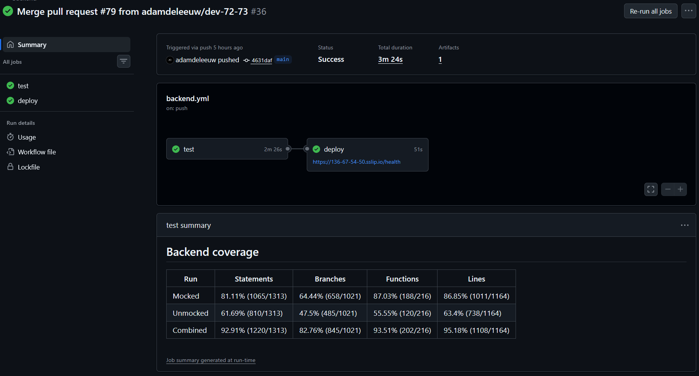
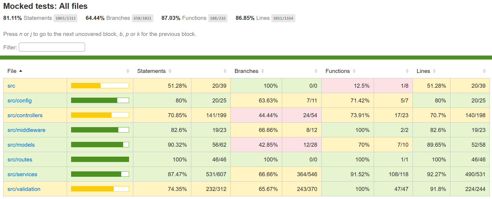
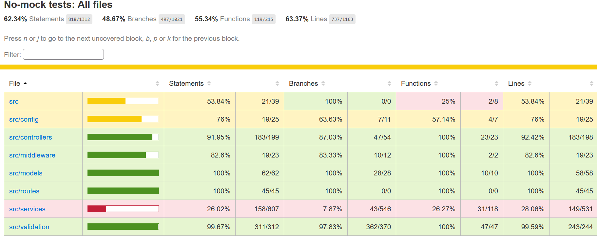
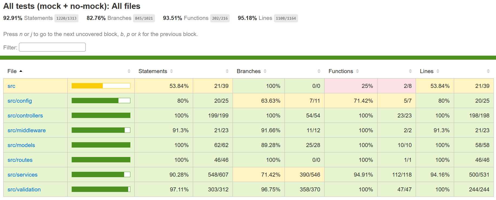

# Testing

## 1. Change History

| **Change Date**   | **Modified Sections** | **Rationale** |
| ----------------- | --------------------- | ------------- |
| 2026-10-15        | 2.1, 2.2, 2.3, 2.4, 2.5, 2.6 | Added the sign-in, sign-out and "get my account" API tests (issue #9) |
| 2026-10-16        | 2.1.2, 2.2, 2.3, 2.4, 2.5, 2.6, 4.1 | Added the CI run and coverage screenshots, the coverage upload to Codacy, the error-handler branch API tests can't reach, and the real front-end test location (issue #9) |
| 2026-10-16        | 2.1.1, 2.1.3, 2.6 | Added the vehicle list and "save my profile" API tests, and labelled each HTML coverage report with its run (issue #10) |
| 2026-10-16        | 2.1.2, 2.2, 2.3, 2.4, 2.5 | Updated the CI run and coverage screenshots and the commit the tests run on for issue #10 |
| 2026-10-19        | 2.1.1, 2.6 | Added the chained route API tests (issue #7) |
| 2026-10-19        | 2.1.1, 2.6 | Added the "save my gas price" and "delete my account" API tests (issue #11) |
| 2026-10-19        | 2.1.1 | The "delete my account" tests now check that the user's trips are deleted, and mock a Trip DB failure |
| 2026-10-19        | 2.1.1, 2.5, 2.6 | Added the "get my trips" API tests for the trip history feature (PR #20), and listed the trip total checks API tests can't reach |
| 2026-10-20        | 2.1.1, 2.1.2, 2.1.3, 2.2, 2.3, 2.4, 2.5, 2.6, 3.1, 3.2, 4.2 | Added the demo trips API tests (PR #24), updated the commit the tests run on and the CI run and coverage screenshots for CP1, switched the install step to `npm ci`, and marked the non-functional and front-end test specifications as coming in a later checkpoint |
| 2026-11-01        | 2.1.1, 2.6, 4.1 | Added the parking spot API tests (issue #71). The "delete my account" tests now check that the user's parking spots are deleted. Added the Map tab's unit tests |
| 2026-11-01        | 2.1.1, 2.6 | Removed the `POST /api/users/me/trips/seed` API tests along with the endpoint and the Map tab's "Load demo trips" button, and updated the `trip.model.ts` coverage note, since no API saves trips now |
| 2026-11-01        | 4.1 | `ParkingSpotsViewModelTest` now also covers tapping a place or a P marker on the map, including the address lookup and its fallback (issue #71) |
| 2026-11-02        | 2.1.1, 2.6, 3.1, 3.2 | Added the Planner endpoint, pure algorithm tests, saved planning preferences, and the response-time NFR test (issue #72) |
| 2026-11-04        | 2.1.1, 2.6, 4.1 | Added the save, status change and delete trip API tests (issue #74), and removed the `trip.model.ts` coverage note, since saving a trip now reaches the total checks. A trip's total time may now be more than its legs (it includes waiting, as the Planner sends it). Added the trip lifecycle, History totals and Navigation unit tests. Routes and saved trips now carry turn-by-turn steps for in-app navigation and a transit line's short name, with planner, save and `normalizeRouteLegs` tests for them |

---

## 2. Back-end Test Specification: APIs

### 2.1. Locations of Back-end Tests and Instructions to Run Them

#### 2.1.1. Tests

Pure planner algorithm tests are in `backend/tests/unit/planner.core.test.ts` and `backend/tests/unit/transit-zones.test.ts`; run them with `cd backend; npm test -- tests/unit/`.

| **Interface** | **Describe Group Location, No Mocks** | **Describe Group Location, With Mocks** | **Mocked Components** |
| ------------- | ------------------------------------- | --------------------------------------- | --------------------- |
| **POST /api/auth/google** | [`backend/tests/no-mock/auth.google.test.ts#L10`](../backend/tests/no-mock/auth.google.test.ts#L10) | [`backend/tests/mock/auth.google.test.ts#L51`](../backend/tests/mock/auth.google.test.ts#L51) | Google ID token verification (`OAuth2Client.verifyIdToken`), User DB, Session DB |
| **POST /api/auth/sign-out** | [`backend/tests/no-mock/auth.sign-out.test.ts#L12`](../backend/tests/no-mock/auth.sign-out.test.ts#L12) | [`backend/tests/mock/auth.sign-out.test.ts#L19`](../backend/tests/mock/auth.sign-out.test.ts#L19) | Session DB |
| **GET /api/users/me** | [`backend/tests/no-mock/users.me.test.ts#L11`](../backend/tests/no-mock/users.me.test.ts#L11) | [`backend/tests/mock/users.me.test.ts#L20`](../backend/tests/mock/users.me.test.ts#L20) | Session DB, User DB |
| **GET /api/users/me/trips** | [`backend/tests/no-mock/users.trips.test.ts#L14`](../backend/tests/no-mock/users.trips.test.ts#L14) | [`backend/tests/mock/users.trips.test.ts#L19`](../backend/tests/mock/users.trips.test.ts#L19) | Trip DB |
| **POST /api/users/me/trips** | [`backend/tests/no-mock/users.trips-save.test.ts#L39`](../backend/tests/no-mock/users.trips-save.test.ts#L39) | [`backend/tests/mock/users.trips-save.test.ts#L20`](../backend/tests/mock/users.trips-save.test.ts#L20) | Trip DB |
| **PATCH /api/users/me/trips/:id** | [`backend/tests/no-mock/users.trips-update.test.ts#L22`](../backend/tests/no-mock/users.trips-update.test.ts#L22) | [`backend/tests/mock/users.trips-update.test.ts#L29`](../backend/tests/mock/users.trips-update.test.ts#L29) | Trip DB |
| **DELETE /api/users/me/trips/:id** | [`backend/tests/no-mock/users.trips-delete.test.ts#L15`](../backend/tests/no-mock/users.trips-delete.test.ts#L15) | [`backend/tests/mock/users.trips-delete.test.ts#L29`](../backend/tests/mock/users.trips-delete.test.ts#L29) | Trip DB |
| **PUT /api/users/me/profile** | [`backend/tests/no-mock/users.profile.test.ts#L31`](../backend/tests/no-mock/users.profile.test.ts#L31) | [`backend/tests/mock/users.profile.test.ts#L21`](../backend/tests/mock/users.profile.test.ts#L21) | User DB |
| **PUT /api/users/me/gas-price** | [`backend/tests/no-mock/users.gas-price.test.ts#L11`](../backend/tests/no-mock/users.gas-price.test.ts#L11) | [`backend/tests/mock/users.gas-price.test.ts#L19`](../backend/tests/mock/users.gas-price.test.ts#L19) | User DB |
| **DELETE /api/users/me** | [`backend/tests/no-mock/users.delete.test.ts#L17`](../backend/tests/no-mock/users.delete.test.ts#L17) | [`backend/tests/mock/users.delete.test.ts#L23`](../backend/tests/mock/users.delete.test.ts#L23) | User DB, Trip DB, Session DB, Google ID token verification (`OAuth2Client.verifyIdToken`, to sign in again after deleting) |
| **GET /api/users/me/parking-spots** | [`backend/tests/no-mock/users.parking-spots.test.ts#L15`](../backend/tests/no-mock/users.parking-spots.test.ts#L15) | [`backend/tests/mock/users.parking-spots.test.ts#L39`](../backend/tests/mock/users.parking-spots.test.ts#L39) | User DB |
| **POST /api/users/me/parking-spots** | [`backend/tests/no-mock/users.parking-spots.test.ts#L61`](../backend/tests/no-mock/users.parking-spots.test.ts#L61) | [`backend/tests/mock/users.parking-spots.test.ts#L74`](../backend/tests/mock/users.parking-spots.test.ts#L74) | User DB |
| **PUT /api/users/me/parking-spots/:id** | [`backend/tests/no-mock/users.parking-spots.test.ts#L255`](../backend/tests/no-mock/users.parking-spots.test.ts#L255) | [`backend/tests/mock/users.parking-spots.test.ts#L110`](../backend/tests/mock/users.parking-spots.test.ts#L110) | User DB |
| **DELETE /api/users/me/parking-spots/:id** | [`backend/tests/no-mock/users.parking-spots.test.ts#L344`](../backend/tests/no-mock/users.parking-spots.test.ts#L344) | [`backend/tests/mock/users.parking-spots.test.ts#L166`](../backend/tests/mock/users.parking-spots.test.ts#L166) | User DB |
| **GET /api/vehicles/makes** | [`backend/tests/no-mock/vehicles.test.ts#L14`](../backend/tests/no-mock/vehicles.test.ts#L14) | _None: nothing external can fail_ | _None_ |
| **GET /api/vehicles/makes/:make/models** | [`backend/tests/no-mock/vehicles.test.ts#L43`](../backend/tests/no-mock/vehicles.test.ts#L43) | _None: nothing external can fail_ | _None_ |
| **GET /health** | [`backend/tests/no-mock/health.test.ts#L6`](../backend/tests/no-mock/health.test.ts#L6) | _None: nothing external can fail_ | _None_ |
| **POST /api/routes/chained** | [`backend/tests/no-mock/routes.chained.test.ts#L22`](../backend/tests/no-mock/routes.chained.test.ts#L22) | [`backend/tests/mock/routes.chained.test.ts#L42`](../backend/tests/mock/routes.chained.test.ts#L42) | Google Routes API (`fetch`) |
| **POST /api/routes/plan** | [`backend/tests/no-mock/routes.plan.test.ts`](../backend/tests/no-mock/routes.plan.test.ts) | [`backend/tests/mock/routes.plan.test.ts`](../backend/tests/mock/routes.plan.test.ts) | Google Routes API (`fetch`), User DB for saved parking spots |
| **PUT /api/users/me/planning-preferences** | [`backend/tests/no-mock/users.planning-preferences.test.ts`](../backend/tests/no-mock/users.planning-preferences.test.ts) | [`backend/tests/mock/users.planning-preferences.test.ts`](../backend/tests/mock/users.planning-preferences.test.ts) | User DB |


"No mocks" tests run against a real MongoDB (the same `mongo:7.0` image deployed on the VM). The sign-in tests that need Google to accept a token are in the mocked group, because automated tests can't get a real Google ID token. Every other test signs users in by adding a user and session straight to the test database (`backend/tests/helpers/auth.ts`), so it doesn't need Google.

The vehicle list endpoints have no mocked group. Their data is `backend/src/data/vehicles.json`, a file in the repo loaded once at startup, so beyond the session check (already covered by the mocked `GET /api/users/me` tests) there is nothing external that can fail.

#### 2.1.2. Commit Hash Where Tests Run

`f0aefbfc15f9685c0e419d9e059d21525dcdd53e` (CP1 baseline; issue #72 changes have not yet been committed or run in CI)

This was the last commit measured in the existing coverage reports. It does not include the current Planner changes.

#### 2.1.3. Explanation on How to Run the Tests

1. **Install the prerequisites:** Node.js 22 and Docker (running).

2. **Clone the repository and install dependencies:**
   ```
   git clone https://github.com/adamdeleeuw/trailmix.git
   cd trailmix/backend
   npm ci
   ```

3. **Run the tests:** from the repository root, run one of these:
   ```
   ./scripts/run-backend-interface-tests.sh        # macOS / Linux
   .\scripts\run-backend-interface-tests.ps1       # Windows
   ```
   The script starts the docker compose `mongo` container (bound to `127.0.0.1:27017`), then runs the mocked tests, the unmocked tests, and both together. Each run writes its coverage report to `backend/coverage/mock`, `backend/coverage/no-mock`, and `backend/coverage/interface`. Open `index.html` in any of those folders to browse the report. Every page's title and heading starts with the run it belongs to ("Mocked tests", "No-mock tests" or "All tests (mock + no-mock)"), so the reports and their screenshots can't be mixed up.

   To use another MongoDB, set `MONGODB_TEST_URI` (e.g. `mongodb://localhost:27017`) and the script won't start the container. Each Jest worker uses its own `trailmix-test-<worker>` database and drops it when it finishes.

### 2.2. GitHub Actions Configuration Location

`~/.github/workflows/backend.yml` (the `test` job runs the same script, with a `mongo:7.0` service container)

Each run posts a coverage table for all three runs on its summary page and uploads the three HTML reports as the `backend-coverage` artifact. The combined report is also uploaded to Codacy.



### 2.3. Jest Coverage Report Screenshots With Mocks



### 2.4. Jest Coverage Report Screenshots Without Mocks



### 2.5. Jest Coverage Report Screenshots, Both Combined



In the existing CP1 coverage run, `src`, `src/config`, `src/middleware` and `src/models` were below 100% only because of the startup code, the error-handler branch, and the trip total checks listed in 2.6. Planner coverage has not yet been measured; see section 3.2.

### 2.6. Lines API Tests Can't Reach

The combined run covers 100% of the statements, branches, functions, and lines in every file issues #7, #9, #10, #11, #71 and #74, and the trip history feature (PR #20) add or change, except for the lines below. Issue #71's files (`parking-spot.service.ts`, `parking-spots.controller.ts`, `parking-spot.validation.ts`, and its changes to `user.model.ts` and `users.route.ts`) and issue #74's files (`trip.model.ts`, `trip.service.ts`, `trips.controller.ts`, `trip.validation.ts` and `common.validation.ts`) have no gaps. API tests build the app with `createApp()` and never start the server process.

| **File** | **Lines** | **Reason** |
| -------- | --------- | ---------- |
| `backend/src/index.ts` | 1–32 | The process entry point: it checks the environment, connects to MongoDB, calls `listen`, and handles SIGINT/SIGTERM. Tests import `createApp()` instead of starting the server, and the test helper connects to the database itself. |
| `backend/src/config/env.ts` | 15–20 | Reading a `PORT` that is set, and rejecting an invalid one. This runs once when the module is first loaded, and tests can't change the environment before that. |
| `backend/src/config/env.ts` | 25–26 | Throwing when a required variable is missing. The test setup always provides `GOOGLE_BACKEND_CLIENT_ID` and `GOOGLE_ROUTES_API_KEY`, and `MONGODB_URI` is only read at startup. |
| `backend/src/config/env.ts` | 36–38, 49–52 | The `mongodbUri` getter and `assertEnv()`, which only `index.ts` calls. |
| `backend/src/middleware/error-handler.middleware.ts` | 17–19 | Handing the error to Express when the response has already started. Every route sends its response in a single call after all of its work succeeds, so no request can fail after headers have gone out. |

---

## 3. Tests of Non-Functional Requirements

### 3.1. Test Locations in Git

`backend/tests/nfr/planner.response-time.test.ts` runs 20 authenticated Drive → Transit requests with three saved spots. It stubs Google using the latency values in `backend/tests/fixtures/planner-google-latencies.json`, verifies each response contains three options, and asserts p95 is at most four seconds. Run it with `scripts/run-backend-nfr-tests.ps1` (Windows) or `scripts/run-backend-nfr-tests.sh` (macOS/Linux).

### 3.2. Test Verification and Logs

Validation run on 2026-11-02 with Node v26.13.0 and npm 11.20.0 (the backend declares Node >=22 <23):

| **Check** | **Result** |
| --- | --- |
| `npm test -- tests/unit/` | Passed: 2 suites, 18 tests |
| `npm run typecheck` | Passed |
| `npm run build` | Passed |
| `scripts/run-backend-interface-tests.ps1` | Passed: 24 suites, 107 tests across mocked, unmocked and combined runs |
| `scripts/run-backend-nfr-tests.ps1` | Passed: 20/20 requests returned three options; p95 141.8 ms |
| Combined interface + unit coverage (`coverage/interface-plus-unit`) | 93.49% statements, 84.63% branches, 94.18% functions, 95.53% lines; the issue #72 100% per-changed-file gate is **not met** |
| `scripts/run-backend.ps1` Docker build | Failed before building the project: Docker could not reach Docker Hub to resolve `docker/dockerfile:1`; `npm run build` above passed locally |

The 20 Planner response times in milliseconds were: 171.8, 139.1, 135.1, 141.4, 135.8, 138.8, 140.6, 138.7, 129.9, 135.2, 126.8, 139.9, 136.3, 141.8, 138.2, 140.9, 140.4, 137.1, 125.2, 122.0. These use the synthetic Google latency fixture; they are not real Google service timings.

Planner-related coverage from the combined interface + unit run:

| **File** | **Statements** | **Branches** | **Functions** | **Lines** |
| --- | ---: | ---: | ---: | ---: |
| `planner.constants.ts` | 100% | 95% | 100% | 100% |
| `planner.core.ts` | 97.22% | 91.02% | 100% | 97.89% |
| `planner.google.service.ts` | 92.5% | 67.88% | 100% | 95.52% |
| `planner.service.ts` | 86.86% | 75.97% | 91.3% | 93.96% |
| `transit-zones.ts` | 100% | 100% | 100% | 100% |
| `plan-request.validation.ts` | 83.33% | 83.01% | 100% | 100% |
| `planning-preferences.validation.ts` | 100% | 81.25% | 100% | 100% |

The uncovered branches in the validators, Google adapter and planner orchestration are input-shape, fallback, and error/replacement paths not exercised by the current cases; they remain test work, not unreachable code. The exact uncovered line/branch data is in `backend/coverage/interface-plus-unit/lcov.info`. Node 26 also produced the declared-engine warning and ts-jest's hybrid-module warning. No live authorized Google response fixture has been recorded; current Google payloads are mocked inline.

---

## 4. Front-end Test Specification

### 4.1. Location in Git of Front-end Test Suite:

`frontend/app/src/androidTest/java/com/example/cpen321application/e2e/` (end-to-end UI tests, run on the emulator)

Unit tests for the app's logic, such as sign-in routing and sign-out, are in `frontend/app/src/test/java/com/example/cpen321application/`. The Map tab's search, parking spots, tapped places and location prompts are covered by `MapSearchViewModelTest`, `ParkingSpotsViewModelTest`, `LocationStateTest` and `ParkingSpotFormatTest` there. The trip lifecycle (issue #74) is covered by `TripHistoryViewModelTest` (save, start, the "End your current trip?" flow, end and delete), `TripTotalsTest` and `TripHistoryListTest` (History's totals and list), and `NavigationFormatTest` (the current leg, arriving, ending early and the Navigation text).

### 4.2. Tests

The front-end test specifications for each use case will be added in a later checkpoint.
