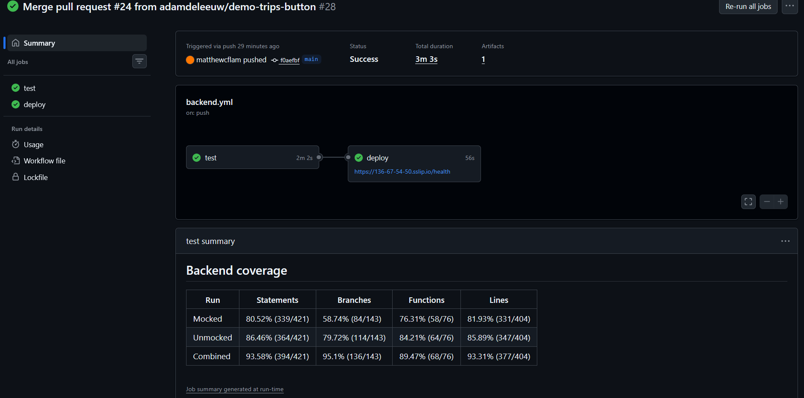
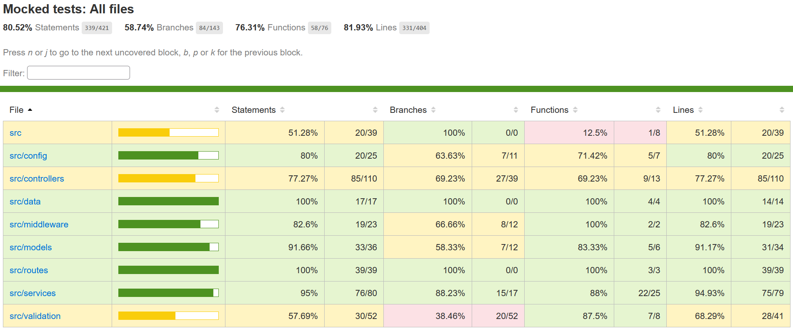
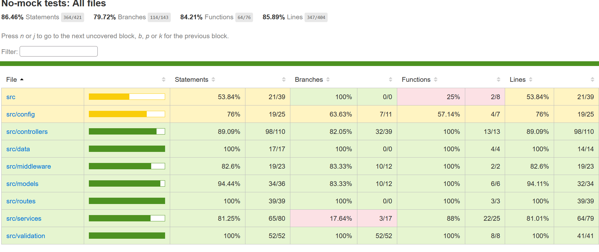
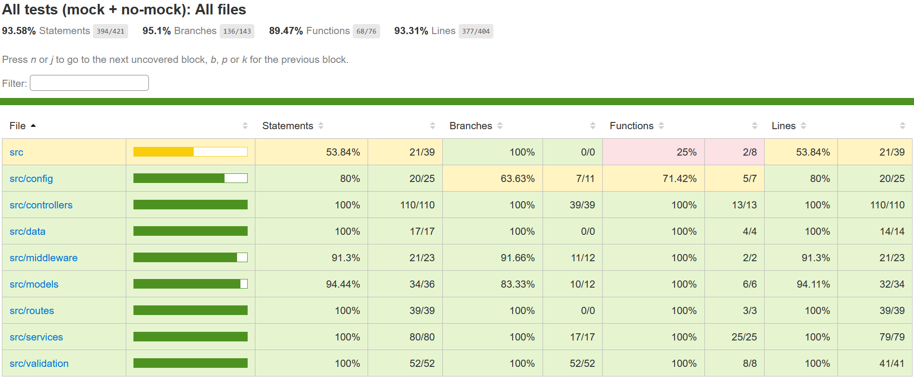

# Testing

## 1. Change History

| **Change Date**   | **Modified Sections** | **Rationale** |
| ----------------- | --------------------- | ------------- |
| 2026-10-15        | 2.1, 2.2, 2.3, 2.4, 2.5, 2.6 | Added the sign-in, sign-out and "get my account" API tests (issue #9) |
| 2026-10-16        | 2.1.2, 2.2, 2.3, 2.4, 2.5, 2.6, 4.1 | Added the CI run and coverage screenshots, the coverage upload to Codacy, the error-handler branch API tests can't reach, and the real front-end test location (issue #9) |
| 2026-10-16        | 2.1.1, 2.1.3, 2.6 | Added the vehicle list and "save my profile" API tests, and labelled each HTML coverage report with its run (issue #10) |
| 2026-10-16        | 2.1.2, 2.2, 2.3, 2.4, 2.5 | Updated the CI run and coverage screenshots and the commit the tests run on for issue #10 |
| 2026-10-19        | 2.1.1, 2.6 | Added the chained route API tests (issue #7) |
| 2026-10-19        | 2.1.1, 2.6 | Added the "save my gas price" and "delete my account" API tests (issue #11) |
| 2026-10-19        | 2.1.1 | The "delete my account" tests now check that the user's trips are deleted, and mock a Trip DB failure |
| 2026-10-19        | 2.1.1, 2.5, 2.6 | Added the "get my trips" API tests for the trip history feature (PR #20), and listed the trip total checks API tests can't reach |
| 2026-10-20        | 2.1.1, 2.1.2, 2.1.3, 2.2, 2.3, 2.4, 2.5, 2.6, 3.1, 3.2, 4.2 | Added the demo trips API tests (PR #24), updated the commit the tests run on and the CI run and coverage screenshots for CP1, switched the install step to `npm ci`, and marked the non-functional and front-end test specifications as coming in a later checkpoint |

---

## 2. Back-end Test Specification: APIs

### 2.1. Locations of Back-end Tests and Instructions to Run Them

#### 2.1.1. Tests

| **Interface** | **Describe Group Location, No Mocks** | **Describe Group Location, With Mocks** | **Mocked Components** |
| ------------- | ------------------------------------- | --------------------------------------- | --------------------- |
| **POST /api/auth/google** | [`backend/tests/no-mock/auth.google.test.ts#L10`](../backend/tests/no-mock/auth.google.test.ts#L10) | [`backend/tests/mock/auth.google.test.ts#L51`](../backend/tests/mock/auth.google.test.ts#L51) | Google ID token verification (`OAuth2Client.verifyIdToken`), User DB, Session DB |
| **POST /api/auth/sign-out** | [`backend/tests/no-mock/auth.sign-out.test.ts#L12`](../backend/tests/no-mock/auth.sign-out.test.ts#L12) | [`backend/tests/mock/auth.sign-out.test.ts#L19`](../backend/tests/mock/auth.sign-out.test.ts#L19) | Session DB |
| **GET /api/users/me** | [`backend/tests/no-mock/users.me.test.ts#L11`](../backend/tests/no-mock/users.me.test.ts#L11) | [`backend/tests/mock/users.me.test.ts#L20`](../backend/tests/mock/users.me.test.ts#L20) | Session DB, User DB |
| **GET /api/users/me/trips** | [`backend/tests/no-mock/users.trips.test.ts#L13`](../backend/tests/no-mock/users.trips.test.ts#L13) | [`backend/tests/mock/users.trips.test.ts#L19`](../backend/tests/mock/users.trips.test.ts#L19) | Trip DB |
| **POST /api/users/me/trips/seed** | [`backend/tests/no-mock/users.trips-seed.test.ts#L24`](../backend/tests/no-mock/users.trips-seed.test.ts#L24) | [`backend/tests/mock/users.trips-seed.test.ts#L19`](../backend/tests/mock/users.trips-seed.test.ts#L19) | Trip DB |
| **PUT /api/users/me/profile** | [`backend/tests/no-mock/users.profile.test.ts#L31`](../backend/tests/no-mock/users.profile.test.ts#L31) | [`backend/tests/mock/users.profile.test.ts#L21`](../backend/tests/mock/users.profile.test.ts#L21) | User DB |
| **PUT /api/users/me/gas-price** | [`backend/tests/no-mock/users.gas-price.test.ts#L11`](../backend/tests/no-mock/users.gas-price.test.ts#L11) | [`backend/tests/mock/users.gas-price.test.ts#L19`](../backend/tests/mock/users.gas-price.test.ts#L19) | User DB |
| **DELETE /api/users/me** | [`backend/tests/no-mock/users.delete.test.ts#L13`](../backend/tests/no-mock/users.delete.test.ts#L13) | [`backend/tests/mock/users.delete.test.ts#L21`](../backend/tests/mock/users.delete.test.ts#L21) | User DB, Trip DB, Session DB, Google ID token verification (`OAuth2Client.verifyIdToken`, to sign in again after deleting) |
| **GET /api/vehicles/makes** | [`backend/tests/no-mock/vehicles.test.ts#L14`](../backend/tests/no-mock/vehicles.test.ts#L14) | _None: nothing external can fail_ | _None_ |
| **GET /api/vehicles/makes/:make/models** | [`backend/tests/no-mock/vehicles.test.ts#L43`](../backend/tests/no-mock/vehicles.test.ts#L43) | _None: nothing external can fail_ | _None_ |
| **GET /health** | [`backend/tests/no-mock/health.test.ts#L6`](../backend/tests/no-mock/health.test.ts#L6) | _None: nothing external can fail_ | _None_ |
| **POST /api/routes/chained** | [`backend/tests/no-mock/routes.chained.test.ts#L22`](../backend/tests/no-mock/routes.chained.test.ts#L22) | [`backend/tests/mock/routes.chained.test.ts#L42`](../backend/tests/mock/routes.chained.test.ts#L42) | Google Routes API (`fetch`) |


"No mocks" tests run against a real MongoDB (the same `mongo:7.0` image deployed on the VM). The sign-in tests that need Google to accept a token are in the mocked group, because automated tests can't get a real Google ID token. Every other test signs users in by adding a user and session straight to the test database (`backend/tests/helpers/auth.ts`), so it doesn't need Google.

The vehicle list endpoints have no mocked group. Their data is `backend/src/data/vehicles.json`, a file in the repo loaded once at startup, so beyond the session check (already covered by the mocked `GET /api/users/me` tests) there is nothing external that can fail.

#### 2.1.2. Commit Hash Where Tests Run

`f0aefbfc15f9685c0e419d9e059d21525dcdd53e`

This is the last commit that changes code. Later commits only change documentation.

#### 2.1.3. Explanation on How to Run the Tests

1. **Install the prerequisites:** Node.js 22 and Docker (running).

2. **Clone the repository and install dependencies:**
   ```
   git clone https://github.com/adamdeleeuw/trailmix.git
   cd trailmix/backend
   npm ci
   ```

3. **Run the tests:** from the repository root, run one of these:
   ```
   ./scripts/run-backend-interface-tests.sh        # macOS / Linux
   .\scripts\run-backend-interface-tests.ps1       # Windows
   ```
   The script starts the docker compose `mongo` container (bound to `127.0.0.1:27017`), then runs the mocked tests, the unmocked tests, and both together. Each run writes its coverage report to `backend/coverage/mock`, `backend/coverage/no-mock`, and `backend/coverage/interface`. Open `index.html` in any of those folders to browse the report. Every page's title and heading starts with the run it belongs to ("Mocked tests", "No-mock tests" or "All tests (mock + no-mock)"), so the reports and their screenshots can't be mixed up.

   To use another MongoDB, set `MONGODB_TEST_URI` (e.g. `mongodb://localhost:27017`) and the script won't start the container. Each Jest worker uses its own `trailmix-test-<worker>` database and drops it when it finishes.

### 2.2. GitHub Actions Configuration Location

`~/.github/workflows/backend.yml` (the `test` job runs the same script, with a `mongo:7.0` service container)

Each run posts a coverage table for all three runs on its summary page and uploads the three HTML reports as the `backend-coverage` artifact. The combined report is also uploaded to Codacy.



### 2.3. Jest Coverage Report Screenshots With Mocks



### 2.4. Jest Coverage Report Screenshots Without Mocks



### 2.5. Jest Coverage Report Screenshots, Both Combined



`src`, `src/config`, `src/middleware` and `src/models` are below 100% only because of the startup code, the error-handler branch, and the trip total checks listed in 2.6. Every other folder is at 100%.

### 2.6. Lines API Tests Can't Reach

The combined run covers 100% of the statements, branches, functions, and lines in every file issues #7, #9, #10, and #11, the trip history feature (PR #20), and the demo trips button (PR #24) add or change, except for the lines below. API tests build the app with `createApp()` and never start the server process.

| **File** | **Lines** | **Reason** |
| -------- | --------- | ---------- |
| `backend/src/index.ts` | 1–32 | The process entry point: it checks the environment, connects to MongoDB, calls `listen`, and handles SIGINT/SIGTERM. Tests import `createApp()` instead of starting the server, and the test helper connects to the database itself. |
| `backend/src/config/env.ts` | 15–20 | Reading a `PORT` that is set, and rejecting an invalid one. This runs once when the module is first loaded, and tests can't change the environment before that. |
| `backend/src/config/env.ts` | 25–26 | Throwing when a required variable is missing. The test setup always provides `GOOGLE_BACKEND_CLIENT_ID` and `GOOGLE_ROUTES_API_KEY`, and `MONGODB_URI` is only read at startup. |
| `backend/src/config/env.ts` | 36–38, 49–52 | The `mongodbUri` getter and `assertEnv()`, which only `index.ts` calls. |
| `backend/src/models/trip.model.ts` | 117, 120 | Rejecting a trip whose `totalDurationSeconds` or `totalCostCents` doesn't equal the sum of its legs. The only API that saves trips, `POST /api/users/me/trips/seed`, works out both totals from the legs (`seedDemoTrips`), so no request can fail this check. |
| `backend/src/middleware/error-handler.middleware.ts` | 17–19 | Handing the error to Express when the response has already started. Every route sends its response in a single call after all of its work succeeds, so no request can fail after headers have gone out. |

---

## 3. Tests of Non-Functional Requirements

### 3.1. Test Locations in Git

The non-functional requirement tests will be added in a later checkpoint.

### 3.2. Test Verification and Logs

The verification steps and logs will be added with the tests in a later checkpoint.

---

## 4. Front-end Test Specification

### 4.1. Location in Git of Front-end Test Suite:

`frontend/app/src/androidTest/java/com/example/cpen321application/e2e/` (end-to-end UI tests, run on the emulator)

Unit tests for the app's logic, such as sign-in routing and sign-out, are in `frontend/app/src/test/java/com/example/cpen321application/`.

### 4.2. Tests

The front-end test specifications for each use case will be added in a later checkpoint.
